# Compiled skill target: `--runtime skill`

Status: design, not built. Written 2026-10-23 against `main` at b3ed28b1
(rote 0.16.0, Claude Code 2.1.309, Codex CLI 0.163.0, fastmcp 4.1.3).

The goal, in the product owner's words: compile a skill into a skill. The
compiled skill keeps the original name and description. When it loads, it
puts the bare minimum into context, runs every tool step start to finish in
code, and hands the agent only what it needs for the decisions that need a
model. Testing has to be easy too: run the original skill and the compiled
skill on the same input, in subagents, and compare the results.

This doc settles the shape. Where it departs from the outline that was
approved, it says so and gives the evidence.

## Decisions at a glance

| # | Question | Decision |
| --- | --- | --- |
| 1 | How the skill runs its code | `rote skill run <name> <verb> ...`, not `python3 scripts/run.py`. The skill's own scripts still do the work. rote only finds them, checks them against the emit manifest, and runs them with an interpreter that has fastmcp. |
| 2 | How input and answers reach the driver | One single-quoted JSON argument, or `--file <path>` for a large one. Never a heredoc or stdin: Claude Code's allow rules refused both heredoc forms in a probe. |
| 3 | What the driver prints | One block per call. The first line is `ROTE/1 <KIND> ...`, where KIND is `JUDGE`, `ASK`, `LOOP`, `DONE` or `ERROR`. The outline had three kinds. Agent loops need `LOOP`, and failures need `ERROR`. A missing login is an `ASK`. |
| 4 | Fanned judges | One `JUDGE` block holds a batch of items, chunked by a token budget. Items are validated one by one, and a bad item is asked again alone. Sending N separate blocks buys no isolation, because all N payloads stay in the same conversation. |
| 5 | Agent loops | `LOOP`: the session's own model runs the bounded task. It can call only the loop's declared tools, through `rote skill run ... tool`, and the driver counts each call against `max_iterations`. The inference helper is an opt-in at emit time (`--judges helper`), never a silent fallback. |
| 6 | Who pays | The session's model, by default. Nothing in the compiled skill bills anyone else unless `--judges helper` was chosen at emit. |
| 7 | MCP auth | rote's registry and token store, through the verbatim `_rote_mcp.py`. A server that needs a login stops the run with an `ASK` that names `rote mcp login`. The run waits in its folder, and `resume` retries the step. |
| 8 | Standalone or rote installed | rote installed. The driver code is stdlib plus fastmcp, so `uv run scripts/run.py` also works without rote for servers that need no login. That is a documented second way in, not a fallback. |
| 9 | Writes | Read-only by default. A skill whose steps write (HubSpot upserts) needs `rote skill trust <name> --allow-writes`, a confirmed Plan that lists every writing tool. The driver bypasses the client's per-tool approval prompts, so this consent cannot be skipped. |
| 10 | Dependencies | If the skill target becomes the first-run default, the base install takes `fastmcp-slim[client]` (+36.6 MB), and dbos goes back to an extra (34.9 MB). That extra is installed on demand, as a confirmed Action, when the user picks a dbos runtime. |

## What is emitted

```
<out>/docs-digest/                  # a skill dir any client can load
├── SKILL.md                        # original name + description; ~12-line body
├── README.md                       # for people: what it runs, how to test, uv path
└── scripts/
    ├── run.py                      # entry point: argv -> _rote_skill.main
    ├── plan.json                   # the run plan (see below); data, no code
    ├── _rote_skill.py              # verbatim rote.skill_target._driver (stdlib)
    ├── _rote_mcp.py                # verbatim rote.mcp._runtime_helper
    ├── _rote_inference.py          # only with --judges helper
    ├── extracted/<module>.py       # the compile's real implementations
    └── .rote-manifest.json         # EmitWriter's hashes; what `rote skill run` checks
```

**The driver is the prefix runner, grown up.** `rote.compiler.prefix.build_plan`
already turns the IR into a plan that mirrors the emitted step bodies: the
payload from `inputs:`, an omitted optional field left out, constants merged
last, one call per fanned element, and `mcp_tool_arguments` for tool
arguments. `_prefix_runner.py` is a stdlib-only interpreter of that plan.
The skill target reuses both:

- `build_plan` moves to `rote.plan` and learns three more step kinds:
  `judge` (the prompt, the input projection, the output schema), `gate` (the
  question, what the person sees, the answer schema, the timeout) and `loop`
  (the task, the tools, the body sub-nodes, the cap). It also gains a live
  `mcp` mode, next to today's recorded mode.
- `_rote_skill.py` is the interpreter. It is resumable, it journals to the
  run folder, it calls MCP live, and it prints blocks.

There is one plan builder, so compile-time verification checks the same
program the skill runs. That is the "dumb interpreter" rule CLAUDE.md
already sets for the prefix runner. Writing the driver as generated Python,
the way the python adapter writes `main.py`, would make a second copy of
the payload semantics. That second copy is how payload semantics drift apart.

## 1. How clients run a skill's scripts today

Checked 2026-10-23 against current docs and the locally installed binaries.
"Unverified" means the docs do not say and no local evidence exists.

| Client | Skill dirs | How the model learns the skill's path | Prompt on first run | Allow rule that sticks | Sandbox / network |
| --- | --- | --- | --- | --- | --- |
| Claude Code 2.1.309 | `~/.claude/skills`, `.claude/skills`, plugins | `${CLAUDE_SKILL_DIR}` is substituted "in two places: the skill's markdown content, and Bash rules in the `allowed-tools` frontmatter" ([skills](https://code.claude.com/docs/en/skills)) | Bash asks ("Do you want to proceed?"), except that `allowed-tools` pre-approves for the invoking turn only: "The grant clears when you send your next message." | "Yes, and don't ask again for: `<prefix> *`", saved to `.claude/settings.local.json`, per repo | No sandbox by default |
| Codex CLI 0.163.0 | `.agents/skills` (cwd up to the repo root), `~/.agents/skills`, `/etc/codex/skills` | The skill listing carries each skill's file path. The prompt says "Resolve relative paths against the directory containing a filesystem-backed `SKILL.md`." | The `workspace-write` sandbox "keeps network access turned off", and writable roots are the workspace and `/tmp` ([approvals](https://learn.chatgpt.com/docs/agent-approvals-security)). So the first call fails, then asks to escalate. | "Yes, and don't ask again for commands that start with ...", saved to `~/.codex/rules/default.rules`, which then runs outside the sandbox | Network off by default. The binary exports `CODEX_SANDBOX` and `CODEX_SANDBOX_NETWORK_DISABLED` (strings in the 0.163.0 binary; exact values unverified) |
| Cursor (IDE, cursor-agent) | `.cursor/skills`, `.agents/skills`, `~/.cursor/skills`, plus `.claude/skills`, `.codex/skills` | Unverified. The docs use paths relative to the skill root. | Auto-review: a classifier reviews commands that need network or write outside the workspace, and prompts only if it blocks them | `Shell(<first token>)`, so `Shell(rote)` allows every rote command | Seatbelt; network blocked by default except package managers |
| VS Code Copilot | `.github/skills`, `.claude/skills`, `.agents/skills`, `~/.copilot/skills` | Unverified ("relative to `SKILL.md`") | Terminal approval for anything not read-only | `chat.tools.terminal.autoApprove` regex keys | Optional sandbox, default unstated |
| Gemini CLI | `.agents/skills`, `.gemini/skills` (workspace and `~`) | `activate_skill` returns the folder tree rooted at the absolute path (source: `activate-skill.ts`) | Two prompts: "Activate Skill: <name>", then the shell call (`ask_user`) | "Allow for all future sessions", or `commandPrefix` rules in `~/.gemini/policies/*.toml` | Unverified |
| OpenCode 1.18.0 | `.opencode/skills`, `.claude/skills`, `.agents/skills` | The skill output says "Base directory for this skill: <dir>" (local binary) | Bash defaults to allow. `external_directory: ask` may fire for paths outside the project (unverified) | "always", for the session | No sandbox |
| agentskills.io | `<root>/<name>/SKILL.md` | "use relative paths from the skill root" | n/a | `allowed-tools` is "Experimental" | `compatibility` (500 chars) is where requirements such as network access go. Body "< 5000 tokens recommended". |

Three facts in that table drive the design:

1. **No path the body names works everywhere.** Only Claude Code
   substitutes `${CLAUDE_SKILL_DIR}`. Elsewhere it reaches the shell as an
   unset variable and becomes `/scripts/run.py`. Cursor and VS Code do not
   document how the model learns the skill's directory. `rote skill run
   <name>` takes the path question away: rote resolves the name through its
   apps registry, where the emit recorded the dir.
2. **`python3` is the wrong interpreter.** The driver needs fastmcp. The
   user's `python3` almost never has it, and rote's own interpreter does.
3. **Approvals stick to command prefixes.** `rote skill run docs-digest`
   is one prefix that covers every call a run makes. A path-based command
   gives a different prefix on every machine, and with Cursor's
   first-token rule, `Shell(python3)` would allow all of Python.

### Measured: which input forms an allow rule accepts

Claude Code 2.1.309, `claude -p`, under `--permission-mode dontAsk`, with the
allow rules `Bash(<py> <drv> start:*)` and `Bash(<py> <drv> begin *)`. The
model was Haiku 5.5, the cost was $0.002, and the probe script is in this
PR's description.

| Form | Result |
| --- | --- |
| `<py> <drv> start <<'JSON'` + body (`:*` rule) | **denied** |
| `<py> <drv> begin <<'JSON'` + body (` *` rule) | **denied** |
| `<py> <drv> start --input-json '{"a": 1}'` | ran |
| the same with an apostrophe as `'\''` | ran |
| `printf '%s' '...' \| <py> <drv> start` | ran |

The first docs-digest measurement run used a heredoc, and the agent hit
exactly this denial. It reported "Bash tool is blocked" and stopped. It did
not do the steps by hand, which is the behavior the SKILL.md asks for.
Codex's own prompt says "NEVER provide a prefix_rule if your command uses a
heredoc". So the protocol takes a single-quoted argument, and `--file` for
an answer too large to pass that way.

### The SKILL.md

The body names only the block kinds the pipeline can produce. Here is
docs-digest, 859 bytes with the frontmatter in the measured prototype:

```markdown
---
name: docs-digest
description: Build a short reading list on a Microsoft technology from Microsoft Learn, plus the wiki outline of the open-source repo that goes with it.
allowed-tools: Bash(rote skill run docs-digest *)
compatibility: Needs rote (pip install rote-cli) and network access to learn.microsoft.com and mcp.deepwiki.com.
metadata:
  rote-compiled: "docs-digest 0.1.0 7c1e...e9"
---

# docs-digest (compiled by rote)

Run this skill only through `rote skill run`. Do not do its steps yourself.

Input, one JSON object: {"topic": string, "repo": "owner/name"}, both required.

Start with one shell command, the input as a single-quoted argument:

    rote skill run docs-digest start '{"topic": "...", "repo": "..."}'

It prints one block. DONE: the JSON after the first line is the result; give
it to the user. ERROR: tell the user what it says; do not work around it.
```

A pipeline with judges, gates or loops adds one line per kind, and every
block carries its own next command in full:

```markdown
- JUDGE: decide as the block asks, then run the `answer` command it shows.
- ASK: put the question to the user, then run `answer` with their reply.
- LOOP: do the task using only the tools it lists, then run `answer`.
- If you lose track: `rote skill run <name> status` prints the pending block again.
```

The name and description are unchanged, so every client triggers on the
compiled skill exactly as it did on the original. `allowed-tools` is read by
Claude Code and ignored elsewhere. OpenCode documents that it ignores
unknown fields. For Cursor, VS Code and Gemini this is unverified, and the
fast suite should load the emitted frontmatter through each client's
documented schema where one exists. `metadata` values are strings, as the
spec requires.

### Prompts a user will see

| Client | `start` | Later calls in the same turn (JUDGE, LOOP tools) | `answer` after the user replies to an ASK |
| --- | --- | --- | --- |
| Claude Code | none (`allowed-tools`) | none | one Bash prompt, unless "don't ask again" was chosen once |
| Codex | the sandboxed try fails, then an escalation prompt | none after "don't ask again for `rote skill run docs-digest`" | none |
| Cursor | the classifier, which prompts only if it blocks | same | same |
| VS Code | terminal approval | each, unless an autoApprove regex is set | same |
| Gemini | skill activation, then a shell prompt | none after "Allow for all future sessions" | none |
| OpenCode | maybe an external-directory ask | none | none |

In Codex the driver should not wait for the network failure. Before its
first MCP call it checks `CODEX_SANDBOX_NETWORK_DISABLED`, and when that
says the network is off, it prints an `ERROR` that names the escalation. The
first PR verifies the variable's values on the real CLI before relying on
it. The README `rote skill install` writes says which rule to save in each
client (`rote skill run <name> *`).

## 2. The driver protocol

### Commands

```
rote skill run <name> start '<input json>' | --file <path>
rote skill run <name> answer <run> <step> '<json>' | --file <path>
rote skill run <name> tool <run> <step> <tool> '<arguments json>'     # LOOP only
rote skill run <name> resume <run>        # after a login, or after a crash
rote skill run <name> status [<run>]      # print the pending block again
rote skill run <name> cancel <run>
rote skill runs [--prune]                 # list runs, sweep expired ones
```

`<name>` resolves through the apps registry (`rote.app_registry`), where
`rote emit --runtime skill` and `rote skill install <dir>` record the skill
dir and the hash of its `.rote-manifest.json`. Before every call, `rote skill
run` checks the dir's files against the manifest. If a file differs, it
refuses with `ERROR` and names `rote skill trust <name>`, which shows the
changed files and records the new hashes once the user confirms. Without
this check, an allow rule for `rote skill run *` would approve any code
dropped into a directory that happens to use a registered name. Then it
runs `scripts/run.py` with its own interpreter, `-I`, and the skill's
scripts dir as the only import root. rote's library code never runs inside
a skill run.

### Blocks

Each call prints exactly one block on stdout and exits 0. ERROR exits 1. A
usage error exits 2 with an `ERROR` block. Progress lines ("calling
mslearn.microsoft_docs_search") go to stderr, which clients show but models
mostly ignore.

```
ROTE/1 JUDGE deal-monitor run=7f3a9c2e41d0 step=classify_thread_step batch=1/2 attempt=1
Decide each item below on its own, as TASK says. Use only what is here.
--- TASK ---
<the judge's prompt template; {{ thread }} means each item's `thread`>
--- ITEMS (json) ---
[{"id": "0", "thread": {...}}, {"id": "1", "thread": {...}}]
--- ANSWER SCHEMA (json) ---
{"type": "object", "properties": {"answers": {"type": "array", "items": {...}}}, ...}
--- NEXT ---
rote skill run deal-monitor answer 7f3a9c2e41d0 classify_thread_step '<your JSON>'
```

- **JUDGE.** For a judge that is not fanned, TASK is the prompt rendered
  exactly as the emitted judge renders it (`_interpolate(PROMPT, inputs)`,
  one shared function). There are no ITEMS, and the answer is one object.
  The emitted judge sends the model only the rendered template, so a field
  the template does not reference is not sent here either. A referenced
  value goes through the same projection the judge's input model applies:
  undeclared keys are dropped where the schema closes the object, and
  nothing is truncated. That is the "only what it needs" rule, and it is
  the compiled pipeline's own rule, not a new one. ANSWER SCHEMA is the
  output schema as written, constraints included.
- **ASK.** Two kinds. `kind=gate` carries the gate's description, its
  rendered `notify.message_template`, what the person needs to see (the
  gate's `inputs:` if it declares any, else the results of the nodes with
  an edge into it, projected the same way), the answer schema and the
  deadline. `kind=login` names the server and the commands: `rote mcp login
  <server>` for a person at a terminal, or `rote mcp login <server>
  --no-wait`, then `--complete` (PR #244), for an agent relaying a URL.
  After either one, `resume <run>`.
- **LOOP.** The task (`_agent_task_prompt`, the same function the loop
  lanes use), the inputs, the tools as `tool` commands with each tool's
  input schema, the turn cap, and the declared output schema for `answer`.
- **DONE.** The exit nodes' results, the same object `run_pipeline`
  returns, followed by `run=<id>` and the path to `result.json`.
- **ERROR.** One cause sentence and the fix command, matching rote's
  first-run error style. The run folder is kept.

### The run loop

```mermaid
sequenceDiagram
  participant A as agent (session model)
  participant R as rote skill run
  participant D as driver (_rote_skill.py)
  participant F as run folder
  participant M as MCP servers (rote logins)
  A->>R: start '<input>'
  R->>R: resolve name, check manifest
  R->>D: exec with rote's interpreter
  D->>D: validate input (missing fields -> ERROR, no folder)
  D->>F: create run, journal
  loop each wave until a decision is needed
    D->>M: tool calls (retries per IR)
    M-->>D: results (never printed)
    D->>D: pure functions in code
    D->>F: node result, atomic write
  end
  alt judge
    D-->>A: JUDGE block
    A->>R: answer <run> <step> '<json>'
    R->>D: validate against schema
    alt invalid (bounded)
      D-->>A: JUDGE again: only the errors and the items still missing
    end
  else gate or login
    D-->>A: ASK block
    A->>A: asks the user (or the user runs rote mcp login)
    A->>R: answer ... or resume <run>
  else agent loop
    D-->>A: LOOP block
    loop at most max_iterations
      A->>R: tool <run> <step> <tool> '<args>'
      R->>M: the one declared tool
      M-->>A: result
    end
    A->>R: answer <run> <step> '<output>'
  end
  D->>F: decision recorded, continue
  D-->>A: DONE result (or ERROR)
```



### Resuming, idempotency, re-entry

- **One journal.** `run.json` holds the plan hash, the input, the pending
  step (node, batch, attempt) and timestamps. `nodes/<id>.json` holds each
  finished node's result. Every write is `atomic_write_text`: a temp file
  in the same dir, then `os.replace`.
- **Re-entry runs from the journal.** Each call loads the journal, skips
  every node with a result, and runs forward to the next decision. So a
  crash, a killed client or a lost conversation costs only the step that
  was running. `resume` and `status` exist because an agent that lost its
  context needs a way back that does not start over.
- **At-least-once tool calls.** A tool call that finished is never
  repeated. One interrupted mid-call is repeated on resume. That matches
  the DBOS step guarantee and the python adapter's retry loop, and the doc
  states it in the README for skills with write tools.
- **Answers are idempotent.** An answer for a step that is no longer
  pending changes nothing and prints the current block with the note
  "already answered". The same answer sent twice has the same effect as
  sending it once. An answer naming the wrong step is refused, and the
  pending block is printed with it.
- **One writer.** `fcntl.flock` on `run.lock`. A second call waits up to
  10 s, then prints `ERROR: run busy`.
- **Plan changes end the run.** If the plan hash in `run.json` differs
  from the skill's current `plan.json`, because the skill was re-emitted
  between calls, the run stops with an `ERROR` that says to start again.
  Mixing two programs' results is never correct.
- **Gate deadlines.** The IR's `timeout` (`72h`) is checked when the
  answer arrives. A late answer is an `ERROR` naming the deadline. Nothing
  polls in between, because no process is left running.

### Malformed answers

The driver parses the argument as JSON, then validates it against the
answer schema with `_schema_errors`. That validator ships today in the
inference helper and covers types, required keys, extra keys, `enum`,
`anyOf` and `items`. The judge's own Pydantic model also enforces `const`,
bounds, `pattern`, `minItems`/`maxItems` and `oneOf`, so PR 1 extends
`_schema_errors` to that subset. A parity test runs the corpus of every
example IR's output schemas through both validators.

- If the answer fails, the driver re-asks with only the error paths
  (`answers[3].step: 7 is not one of [1, 2, 3, 4, 5, 6]`) and the ids still
  missing. The payload is already in the conversation, so it is not printed
  again.
- In a batch, the valid items are kept, and only the bad or missing ones
  are asked for again.
- `MAX_ANSWER_ATTEMPTS = 3` per step. After that, the result is an `ERROR`
  with the last errors. The run stays resumable after the agent or the
  user fixes the answer.
- An answer that is not JSON at all counts as an attempt too. The error
  names the parser's position, and the block gives the `--file` form, since
  shell quoting is the usual cause.

### Where runs live, and cleanup

`$ROTE_SKILL_RUN_DIR`, else `$XDG_STATE_HOME/rote/skill-runs`, else
`~/.local/state/rote/skill-runs`, as `<skill>/<run id>/`, mode 0700 (tool
results can be private). The run folder is never in the user's repo, and
never in the client's cwd. `ROTE_SKILL_RUN_DIR` joins
`rote.isolation.STATE_PATHS`, so the tests and `scripts/isolated-rote` move
it.

Every `start` sweeps the skill's own folder:

- a DONE or cancelled run after 7 days,
- an ERROR run after 7 days,
- a waiting run after its gate deadline plus 1 day, or 30 days when no
  deadline applies.

`rote skill runs --prune` does the same on demand. The sweep removes only
dirs holding a `run.json` it can parse, so a stray path is never deleted.

### Errors

| Cause | Block | Fix it names |
| --- | --- | --- |
| Input missing a required field, or not an object | ERROR (no run folder created) | the field names |
| No endpoint for a server (`RoteMcpConfigError`) | ERROR | `rote mcp add <server> <url>`, `ROTE_MCP_<SERVER>_URL` |
| Login needed (`RoteMcpAuthNeeded`) | ASK kind=login | `rote mcp login <server>`, then `resume` |
| A write tool in a read-only skill | ERROR | `rote skill trust <name> --allow-writes` |
| A server asks for input mid-call (`RoteMcpInputRequired`) | ERROR | none. A plain failure, as on every runtime |
| A tool still failing after the IR's retries | ERROR | the tool's error text, `resume` to retry |
| An extracted function raises | ERROR | file:line, as the prefix runner reports it |
| A stub (`STUB_SENTINEL`) | refused at emit, like `rote run`'s preflight | `rote compile` again, or `--allow-stubs` |
| Network disabled by the Codex sandbox | ERROR, before any call | rerun with escalation |

Config, auth and input-required errors are never retried, exactly as the
other runtimes' retry opt-outs exclude them.

## 3. Judges, fanned judges and agent loops

Accuracy first, then tokens. The comparison point is what the original
skill did, because the compiled skill is measured against it.

**In-session judges.** The original skill made every judgment inside one
agent context, next to every tool result it had read. A `JUDGE` block keeps
the same model, but shows it only what the compiled pipeline's judge would
see. On accuracy, that is at least as good as the original. It can differ
from the workflow runtimes in two ways, and both are disclosed in the
compile report:

- the model is the session's (it could be GPT-5.5 in Codex), not the IR's
  `signature_spec.model`;
- the decoding is not schema-locked. The driver's validation makes up for
  that with a bounded re-ask, and an answer never passes unvalidated.

**Fanned judges: batch them.** The obvious alternative, one block per
element, sounds more faithful to the IR's per-element semantics, but it is
not more isolated. Element 1's payload is still in the conversation when
the model judges element 2. Per-element blocks cost N turns, each one
re-reading the client's whole base context, and buy nothing. So:

- **One block per batch.** Shared (non-element) inputs appear once, and
  each element appears with an `id`. For bdr's `personalize_email`, `intel`
  and `campaign_type` are sent once, not 25 times.
- **Chunk by budget.** At most 10 items, or about 12k tokens of items, or
  the item count whose answers fit in 8k output tokens (estimated from the
  output schema), whichever is smallest. All three are named constants in
  the driver.
- **Validate per item**, and re-ask only the items that fail.

When per-element isolation is the requirement, `--judges helper` gives it:
the driver calls `call_judge` through `_rote_inference.py`, once per
element, on the IR's model, through the existing lanes. That makes a second
payer, and on a non-Claude client it needs a key or a Claude subscription,
so it is a choice made at emit and recorded in the manifest, never chosen
at run time.

**Agent loops: `LOOP`, in the session.** The session model runs the bounded
task. Three reasons:

- An agent loop is a model working with tools. The session model is the
  strongest model in the room, and the original skill used it for this
  same work.
- A subprocess loop (`claude -p`) would lose the user's conversation, add a
  payer, and not exist at all on Codex or Cursor without a Claude
  subscription.
- The driver keeps the guarantees that matter by proxying the tools.

That proxy gives four guarantees:

- Only the loop's declared `tools` can be called, each one through its
  server in `tool_servers`, through rote's logins, with the read-only gate.
- Loop-body sub-nodes are tools too. A `pure_function` or `external_call`
  body runs in code with its constants merged last, as `_text_result` does
  today. A judge body (bdr's `vet_contact`) is given in the task as a rule
  the model applies itself, with its prompt and output schema.
- The driver counts calls, and past `max_iterations` it refuses further
  tool calls and asks for the answer.
- The answer is validated against `agent_loop_output`, the same contract
  all six runtimes use.

The tool results do enter context. That is in the nature of a loop, and the
context accounting below counts it.

## 4. MCP auth, and whether rote must be installed

The driver calls MCP through `_rote_mcp.py`, a byte-for-byte copy of
`rote.mcp._runtime_helper`. So endpoint resolution (`ROTE_MCP_<S>_URL` >
registry > the URL the IR recorded), `${VAR}` header templates, the token
store, silent refresh, the 401 hook and the read-only predicate are the same
code the four MCP runtimes run. The client's own MCP configuration and
logins play no part. The setup path is the one first-run already builds:
`rote mcp import` copies the servers, and `rote mcp login` covers the ones
that need OAuth.

**When a server is not logged in:** the driver raises nothing past its own
loop. It records the step as waiting on `login:<server>` and prints `ASK
kind=login`. That is park-on-auth with the run folder in place of DBOS's
`recv`: the run waits on disk, the user (or the agent, with `--no-wait` /
`--complete`) logs in, and `resume` runs the step again. The driver never
opens a browser, which keeps the helper's never-interactive rule.

**Recommendation: rote installed, code standalone.**

- The skill's code is standalone in the same sense the emitted apps are:
  stdlib-only verbatim copies, plus one third-party import, fastmcp, made
  inside functions. `scripts/run.py` carries a PEP 723 header
  (`dependencies = ["fastmcp-slim[client]>=4.1.3,<5"]`), so `uv run
  scripts/run.py start '...'` works on a machine without rote. A skill
  whose servers need no login (docs-digest) runs that way end to end. The
  README says so. The SKILL.md does not, so the agent has one command.
- `rote skill run` is the command in SKILL.md because it fixes three things
  the bare script cannot: the interpreter (fastmcp), the path (the name
  resolves through the registry), and the trust check (the manifest).
  Logins need rote anyway.

## 5. How the IR maps, and what is guaranteed

| IR | In the compiled skill |
| --- | --- |
| `pure_function` | code, `impl(**{**payload, <constants>})`, IR retries as visible loops |
| `external_call` + `mcp:` | `call_mcp_tool` with `mcp_tool_arguments`, never retried on config, auth or input-required errors |
| `external_call` + `impl` (`--backend api`) | the module's code; refused at emit if it is a stub |
| `llm_judge` | `JUDGE`, or the inference helper under `--judges helper` |
| `agent_loop` | `LOOP` with the tool proxy |
| `hitl_gate` | `ASK kind=gate`. The deadline comes from `timeout`, and the answer is the gate's result |
| `mandatory: true` | the node is in the plan unconditionally. The driver has no skip path |
| `constants` | merged last in the step body, as every Python runtime does. `require_constant_parameters` runs at emit |
| input schema | `_missing_inputs_error` before the run folder exists. Optional fields are left out, not None |
| `fan_out` (code nodes) | one call per element, in input order, `_fan_out_list`'s message when the list is missing |
| `fan_out` (judges) | batched `JUDGE`, per-item validation |
| parallel waves | a thread pool for MCP and code nodes, as the python adapter does |

**What holds, stated honestly.** Inside the driver the guarantees are the
python runtime's, plus the resumable journal: mandatory nodes run, constants
reach their implementations, inputs are checked, tool arguments come from
the IR, and every decision is validated before anything downstream reads
it. Outside the driver, nothing can be enforced, because the agent is free
not to call it. Three cases:

- **The agent can skip the driver** and do the work by hand. The SKILL.md
  says not to. The measured runs did not (the denied run reported the
  denial and stopped). The eval treats a result with no matching run folder
  as a failure, "bypassed the driver".
- **The agent can answer an ASK itself.** No in-band check can tell a
  person's answer from the agent's. A gate whose point is a real human's
  approval belongs on a durable runtime, and the compile report says so for
  each gate.
- **JUDGE answers are the model's judgment.** They are validated for shape,
  not for truth. That is the same as every runtime's judge.

The README and compile report state it in one line: "Steps run as compiled.
Whether the agent runs the skill through its driver, and what it answers
at JUDGE and ASK, is up to the agent."

## 6. Context accounting

### The formula

Tokens billed for one run in an agent client:

```
I = Σ_{t=1..T} (B + K_t)            input tokens, all cache buckets
K_t = S + Σ_{everything the skill produced before turn t}
```

- `B` is the client's base per turn: system prompt plus tool definitions,
  the same for any skill in a given setup.
- `S` is the skill text in context.
- `T` is the number of turns.

What the skill leaves behind in the conversation, which every later turn
of the user's session pays for again, is `K_T`, the residual.

- Original skill: `S` = SKILL.md + the references read. The skill produces
  every tool result plus the agent's own tool arguments and final output.
  `T` grows with the number of steps.
- Compiled skill: `S` = the stub. The skill produces the printed blocks,
  the agent's answers, and DONE. `T = 1 + J + 2G + L + 1`, for J judge
  batches, G gates, L loop tool calls, and the final reply. The eval
  harness adds one turn to write `result.json`, on both sides.

Token counts below are chars / 3.8 (`Priors.chars_per_token`, rote's
labeled heuristic) unless they say "measured".

### docs-digest, measured

Both runs used the isolated skill-run harness (`skill_run_isolation_args`),
`claude -p`, claude-sonnet-4-6, on `skill/input.json`. The compiled side is
a hand-built prototype of this design: the stub above, plus a driver that
calls the two tools through the real `_rote_mcp.py` (fastmcp 4.1.3, clean
venv) and runs the committed `extracted/` functions. Its digest was
byte-identical to the recorded skill run's and pipeline run's.

| | Original (reference.json, 2026-10-22) | Compiled (prototype, 2026-10-23) |
| --- | --- | --- |
| Turns | 4 | 3 |
| Input tokens, measured | 45,461 (5 + 34,948 read + 10,508 write) | 34,968 (5 + 31,899 read + 3,064 write) |
| Output tokens, measured | 966 | 988 |
| Wall time, measured | 14.9 s | 19.6 s (the driver alone: 2.4-2.9 s) |
| Cost (client estimate) | $0.088 | $0.043 (cache warm from a run 2 minutes earlier. That cold run cost $0.092) |
| Skill text `S` | 1,067 chars, 281 tok | 859 chars, 226 tok |
| Tool results in context | 28,831 chars, 7,587 tok (Microsoft Learn's search, page excerpts and all) | 0 |
| Blocks printed | n/a | DONE, 1,587 chars, 418 tok |
| Residual `K_T` (+ result.json write) | ~8,300 tok | ~1,050 tok (**-87%**) |

What this shows, and what it does not:

- **The residual drops 87%.** That is the number that matters in a real
  session. The search results stay in the conversation after the original
  skill finishes, and every later message re-reads them.
- **Total input drops only 23% here**, because `B` dominates a skill this
  small. The compiled run's last turn read 12,440 tokens, of which about
  11.4k is the base. The compiled side's base is also larger than the
  original's: it carries the Bash tool, which the original harness leaves
  out on purpose. Solving the original's turns for its base gives about
  4.9k. So in this harness, Bash's definition costs about 6k tokens a turn,
  and that skews the comparison against the compiled skill. In a real
  Claude Code session, Bash is always loaded and `B` is the same on both
  sides. The eval must remove this skew (see section 7).
- **Cost is not comparable from two single runs.** The cache state decided
  it: the same compiled run cost $0.092 cold and $0.043 warm. Cost belongs
  in the eval as a mean over trials with the cache state recorded.
- **Wall time did not improve** in one sample each: the model turns
  (about 5-6 s each) dominate, and the 2.5 s driver is not the bottleneck.
  Fewer turns is the lever, which is why fanned judges are batched.

### ops-report, expense-audit, bdr-outreach, from IRs and fixtures

The original side is measured: the fidelity references, three trials per
case, claude-sonnet-4-6, same harness. The compiled side is computed from
the IR and the committed fixtures with the formula, using `B = 11.4k` (the
measured base with Bash) for both sides, so the toolsets match.

| Skill (case) | Original, measured | Original `S` + data in context | Compiled `T` | Compiled `K_T` | Billed input, same `B` (est.) |
| --- | --- | --- | --- | --- | --- |
| ops-report (busy_day) | 12-14 turns, $0.28-0.32, 68-84 s | SKILL.md 862 + 4 tool results 659 + ask/answer 386 + output 178 = ~2.1k tok | 5 (start, ask, answer, write, reply) | stub ~240 + ASK ~450 + answer 140 + DONE 178 + write 178 = ~1.2k | ~168k to ~61k (**-64%**) |
| expense-audit (base) | 8-9 turns, $0.47-0.66, 148-241 s | SKILL.md + 3 refs 2,093 + input 640 + ask 368 + output 428 = ~3.5k | 5 | stub ~320 + input 640 + ASK ~500 + DONE 428 + write 428 = ~2.3k | ~121k to ~65k (**-46%**) |
| bdr-outreach (25 contacts, assumed) | not recorded | SKILL.md + 6 refs, 42.4k chars = 11.2k, plus every ZoomInfo and HubSpot result | 2 LOOPs (their tool calls), 1 JUDGE batch for `personalize_email`, 2 ASKs | the loops' tool traffic + ~3.5k JUDGE input + ~2k answers | not estimated: the loops dominate, and neither the loops' turn counts nor their tool results have fixtures |

Where the savings come from differs by skill, and the doc should not
promise one number:

- **docs-digest** saves on data: one 28 KB tool result never reaches the
  model.
- **ops-report and expense-audit** save on turns. Their fixtures are small
  (2.5 KB and an input of 2.4 KB), but the original agent took 8-14 turns,
  and each turn re-read `B`. The compiled skill takes 5.
- **bdr-outreach** saves least, relative to its size. Its two heaviest
  phases are agent loops, and a loop's tool results enter context in both
  versions. The saving is the 11.2k of references, the batched
  personalization, and the HubSpot and exclusion steps moving into code.
  Its `expected/` external_calls are also stubs today, so it cannot run as
  a compiled skill until they are implemented or bound to MCP.

One more thing to watch: expense-audit's input (640 tokens) is typed out by
the agent as the `start` argument, and output tokens cost five times input
tokens. When the user's input is already a file, the SKILL.md tells the
agent to pass `--file <path>`.

## 7. Testing

### The fast suite (no inference, no network)

- **Emission.** The SKILL.md frontmatter keeps the source's `name` and
  `description` byte for byte (from `pipeline.source_skill`). The body
  lists exactly the block kinds the pipeline can produce: docs-digest has
  no JUDGE line, deal-monitor has one. The emitted `_rote_mcp.py` and
  `_rote_skill.py` are byte-equal to their modules, as
  `tests/test_inference.py` pins the inference helper. Emitted text goes
  through `safe_docstring_line` and `escape_invisible`, so a description
  holding a bidi override cannot hide a line in SKILL.md (invariant 7).
  Every committed example either emits, or is refused with the reason
  (bdr's stubs).
- **Driver e2e.** This runs `rote skill run` as a subprocess against
  `tests/_helpers` fixture MCP servers, with scripted answers and isolated
  state. It needs no model. One test per behavior, each written to fail:
  - docs-digest returns the recorded digest from the reference's tool
    calls (the same fixtures `test_docs_digest_demo.py` uses);
  - deal-monitor's fanned judge comes back as ceil(N/10) batches, and
    `FAN_OUT_ELEMENTS` > 1, so a no-op fan cannot pass;
  - an answer with one bad item gets back only that item; three bad
    answers end in ERROR; an answer for a step already done changes
    nothing;
  - killing the driver after the first wave and calling `resume` does not
    call the first wave's tools again (the fixture server's hit log is
    the evidence);
  - a 401 from the fixture prints `ASK kind=login`, and `resume` after a
    token appears completes the run;
  - a write tool in a read-only skill is refused before it is called;
  - a changed `extracted/` file is refused by the manifest check;
  - two concurrent `answer` calls leave one journal entry;
  - the run folder lands under `ROTE_SKILL_RUN_DIR`, mode 0700, and the
    sweep removes an expired run and leaves a foreign dir alone.
- **Plan parity.** `rote.plan` serves the prefix runner and the driver. A
  test runs both on the same plan and recorded calls, and requires the same
  node results.
- **Mutations to try** (CLAUDE.md's discipline): drop the per-item re-ask;
  send fields the template does not reference; skip the manifest check;
  make `answer` non-idempotent; retry a config error. Each one must fail
  the suite.

### Evals (inference, run on purpose)

`rote.eval.skill_ab` runs the original and the compiled skill as `claude
-p` subagents on the same input, through `skill_run_isolation_args`. The
compiled side also gets `Bash(rote skill run <name> *)`, and both sides get
the rote gates server, so an ASK and the original's `ask_person` receive the
case's fixed answers. For each pair it reports:

- **Fields:** the `rote.proof` field-by-field statuses (`matched`,
  `differs`, `drifted`), from the IR's exit nodes and the case's
  `output_fields`. On the compiled side it compares both the agent's
  `result.json` and the run folder's `result.json`, so an agent that
  misreports DONE shows up.
- **Bypass:** a compiled result with no matching run folder fails as
  "bypassed the driver".
- **Context:** `K` per side, measured as `I - T*B`, where `B` comes from a
  control run per toolset (the same flags, the prompt "reply ok"; about
  $0.01 each, once per eval). This removes the Bash skew measured above.
- **Totals:** input tokens per cache bucket, output tokens, turns, wall
  time and cost, as means over trials, with the cache state recorded.

**`rote try` is rebuilt on this** (#250 is paused for it):

- **Free path** (`rote try`): runs the bundled docs-digest compiled skill's
  driver directly. With no judges there is nothing for a model to do, so
  the result arrives in about 3 s and is compared with the recorded
  original. That is still zero model calls, and it now exercises the
  shipped skill rather than a dbos app.
- **Live path** (`--live`): the original skill and the compiled skill, each
  in a subagent on the same input, through `skill_ab`, with the context,
  token, time and cost table. For a user's skill, the compile comes first.

review6's three required fixes carry over from #250:

1. **Pin the compile argv,** including `--local`: `rote compile <skill>
   --runtime skill --local --sample-input <input> --no-eval --out <dir>`.
   The exact argv is printed in the plan and recorded in the `--json`
   result, so a logged-in user's cloud default can never change what was
   measured.
2. **Disclose or pin the decider.** `--decider` and `--structure` are
   resolved before the plan is shown, and the plan names them with their
   source ("decider: rules, pinned by rote try"). `rote try` pins `--decider
   rules`, because `auto` depends on which credentials happen to be
   present.
3. **No same-result claim from zero fields.** When no field is expected to
   match exactly, the headline reads "no fields to compare exactly", not
   "same result", and the exit code is 1. `tests/test_try.py` covers it
   with a skill whose fields are all `drifts`.

## 8. Dependencies

Measured 2026-10-23 in clean `uv venv` (Python 3.12) environments, installed
`--offline` from the uv cache, `du -sk` of site-packages:

| Install | Size | Packages |
| --- | --- | --- |
| `rote-cli` (main) | 28.2 MB | 20 |
| `rote-cli[mcp]` (fastmcp 4.1.3 + httpx) | 72.1 MB | 78 |
| `rote-cli[dbos]` (dbos 3.3.0) | 63.2 MB | 30 |
| `rote-cli[mcp,dbos]` (what #249 makes the base) | 106.5 MB | 87 |
| `rote-cli` + `fastmcp-slim[client]==4.1.3` | 64.8 MB | 62 |

So of the 78.2 MB that #249 adds, fastmcp's share is 43.8 MB (56%) and
dbos's is 34.9 MB (45%). They overlap by 0.5 MB, which is `click`. The
largest single package fastmcp brings is `cryptography`, at 11.4 MB (via
authlib, which OAuth needs). `fastmcp-slim[client]` is enough for
everything the helper does: `Client`, `StreamableHttpTransport` and `OAuth`
import from it, and `mcp_client` builds a client. It is 7.2 MB smaller
than full fastmcp. `rote serve` still needs the server half.

If the skill target becomes the first-run default:

- **The base install** takes `fastmcp-slim[client]>=4.1.3,<5` and httpx:
  28.2 to 64.8 MB, instead of #249's 106.5 MB. The first run (`rote try`,
  `rote mcp login`, compile's tool grounding, every compiled skill) needs
  nothing else. `FASTMCP_REQUIREMENT` and the emitted README follow, and
  the requirement range stays one fact, pinned by a test against
  pyproject.
- **dbos goes back to an extra**, and so do `serve` (full fastmcp) and
  temporal. Choosing a runtime whose extra is missing (`compile --runtime
  dbos`, `rote init` picking dbos, `rote run` on a dbos app) builds a Plan
  with one Action: `Launch(<installer>)` plus `Contact(pypi.org)`. The
  command is the one `rote.extras.reinstall_hint` already derives for the
  install method (`uv tool install --with 'rote-cli[dbos]'`, `pip install
  'rote-cli[dbos]'`, `uvx --from 'rote-cli[dbos]'`). A person confirms it;
  without a person, `--yes` applies it. It is never done silently.
- **#249 should not merge as written.** Its base-dependency move should be
  narrowed to fastmcp-slim, and its doctor checks and hint split kept.

## 9. PR plan

Each PR is independently reviewable, and the order is the dependency order.
Estimates are focused working minutes, including tests and the
break-the-code check.

| # | PR | Builds on | Minutes |
| --- | --- | --- | --- |
| 1 | `rote.plan`: move `build_plan` out of prefix, add judge, gate and loop steps and a live-MCP mode; extend `_schema_errors` to the Pydantic subset, with the parity test | none | 150 |
| 2 | `rote.skill_target._driver` (stdlib): the resumable interpreter, journal, locking, blocks, per-item validation and re-ask, retries, the sweep, `CODEX_SANDBOX_NETWORK_DISABLED` check (verified on the real CLI first) | 1 | 300 |
| 3 | `--runtime skill` adapter: SKILL.md stub, README, `plan.json`, verbatim helpers, manifest, apps-registry entry, stub refusal, `--judges session\|helper` | 1, 2 | 150 |
| 4 | `rote skill run / status / resume / cancel / runs / trust / install`: name resolution, manifest check, `--allow-writes` consent Plan | 3 | 150 |
| 5 | `LOOP`: the tool proxy, iteration cap, body sub-nodes, output contract | 2, 4 | 180 |
| 6 | Driver e2e suite against fixture MCP servers (the list in section 7), wired into the Python e2e CI job | 4, 5 | 180 |
| 7 | `rote.eval.skill_ab`: the paired subagent runs, control runs for `B`, field compare, bypass check, corpus records; one measured eval on docs-digest, ops-report and expense-audit (about $3) | 4 | 180 |
| 8 | `rote try` rebuilt on 7, closing #250, with review6's three fixes | 7 | 150 |
| 9 | Dependencies: `fastmcp-slim[client]` in the base; dbos, serve and temporal as extras installed by a confirmed Action; supersede #249 | 3 | 120 |
| 10 | Make the skill target the first-run default (`rote init`, `rote setup`'s skill step, docs, CHANGELOG), once 7's numbers are in | 8, 9 | 60 |

Total: about 1,620 minutes (27 hours). PRs 1 to 6 are the product. Number 7
is what decides whether 10 happens: the default should flip on measured
field fidelity and context, not on this doc's estimates.

## Open questions for the product owner

1. **Batch size against accuracy.** The batch caps (10 items, about 12k
   tokens) are guesses. PR 7 should sweep 1, 5, 10 and 20 on deal-monitor's
   two fanned judges against `--judges helper`, and set the default from
   that.
2. **Gates that need a real person.** Should the compiler refuse
   `--runtime skill` for a gate the skill marks as an approval, or only
   warn? This doc warns.
3. **Cross-turn ASK in Claude Code.** After the user replies, `allowed-tools`
   no longer covers `answer`, so there is one prompt unless the user saved
   the rule. Should `rote skill install` offer to write the rule into the
   user's Claude Code settings as a confirmed Action? That would touch the
   client's config, so this doc does not assume it.
