# Compiled skill target: `--runtime skill`

Status: design, not built. Written 2026-10-23 against `main` at b3ed28b1
(rote 0.16.0, Claude Code 2.1.309, Codex CLI 0.163.0, fastmcp 4.1.3).

The goal, in the product owner's words: compile a skill into a skill. The
compiled skill keeps the original name and description. When it loads, it
puts the bare minimum into context, runs every tool step start to finish in
code, and hands the agent only what it needs for the decisions that need a
model. Testing has to be easy too: run the original skill and the compiled
skill on the same input, in subagents, and compare the results.

This doc settles the shape. Where it departs from the outline that was
approved, it says so and gives the evidence.

## Three tiers: program, agent, human

A compiled skill is a Python program that runs as far as it can on its own.
It escalates in one direction only: program, then agent, then human.

| Tier | Does | Escalates when |
| --- | --- | --- |
| Program (the driver) | every tool call, every pure function, retries, validation | a step needs a model (`DECIDE`, `LOOP`) or a person (`HUMAN`) |
| Agent (the session model) | judges and agent loops, answered by itself | a block is `HUMAN`. It never asks the user about a `DECIDE` or a `LOOP` |
| Human (through the agent) | gate approvals and logins | never |

The program never talks to the person directly. The agent sits between them
because a person answers in any form: a sentence, a "yes", a pasted table.
The agent relays the question in plain words, then translates the reply
into the answer schema. If the reply does not map cleanly onto the schema,
the agent asks the person again. It never guesses a field the person did
not give.

The tier is a checked fact, not a convention. A gate answer must carry the
person's words (`--said`), the driver refuses `--said` on an agent answer,
and the journal records who answered (section 2).

## Decisions at a glance

| # | Question | Decision |
| --- | --- | --- |
| 1 | How the skill runs its code | `rote skill run <name> <verb> ...`, not `python3 scripts/run.py`. The skill's own scripts still do the work. rote only finds them, checks them against the emit manifest, and runs them with an interpreter that has fastmcp. |
| 2 | How input and answers reach the driver | One single-quoted JSON argument, or `--file <path>` for a large one or one already in a file. Never a heredoc or stdin: Claude Code's allow rules refused both heredoc forms in a probe. |
| 3 | What the driver prints | One block per call. The first line is `ROTE/1 <KIND> ...`, where KIND is `DECIDE`, `LOOP`, `HUMAN`, `DONE` or `ERROR`. The kind names the tier that answers. A missing login is a `HUMAN kind=login`. |
| 4 | Fanned judges | One `DECIDE` block holds a batch of items, chunked by a token budget. Items are validated one by one, and a bad item is asked again alone. Sending N separate blocks buys no isolation, because all N payloads stay in the same conversation. |
| 5 | Agent loops | `LOOP`: the session's own model runs the bounded task. It can call only the loop's declared tools, through `rote skill run ... tool`, and the driver counts each call against `max_iterations`. The inference helper is an opt-in at emit time (`--judges helper`), never a silent fallback. |
| 6 | Who pays | The session's model, by default. Nothing in the compiled skill bills anyone else unless `--judges helper` was chosen at emit. |
| 7 | MCP auth | rote's registry and token store, through the verbatim `_rote_mcp.py`. A server that needs a login stops the run with a `HUMAN kind=login` that names `rote mcp login`. The run waits in its folder, and `resume` retries the step. |
| 8 | Standalone or rote installed | rote installed. The driver code is stdlib plus fastmcp, so `uv run scripts/run.py` also works without rote for servers that need no login. That is a documented second way in, not a fallback. |
| 9 | Writes | Read-only by default. A skill whose steps write (HubSpot upserts) needs `rote skill trust <name> --allow-writes`, a confirmed Plan that lists every writing tool. The driver bypasses the client's per-tool approval prompts, so this consent cannot be skipped. |
| 10 | Dependencies | If the skill target becomes the first-run default, the base install takes `fastmcp-slim[client]` (+36.6 MB), and dbos goes back to an extra (34.9 MB). That extra is installed on demand, as a confirmed Action, when the user picks a dbos runtime. |

## What is emitted

```
<out>/docs-digest/                  # a skill dir any client can load
├── SKILL.md                        # original name + description; ~12-line body
├── README.md                       # for people: what it runs, how to test, uv path
├── .rote-manifest.json             # EmitWriter's hashes of every file here, SKILL.md
│                                   # included, plus the skill's name and judge mode
└── scripts/
    ├── run.py                      # entry point: argv -> _rote_skill.main
    ├── plan.json                   # the run plan (see below); data, no code
    ├── _rote_skill.py              # verbatim rote.skill_target._driver (stdlib)
    ├── _rote_inference.py          # verbatim rote.inference._runtime_helper (stdlib at
    │                               # module level): the schema validator, and the
    │                               # judges with --judges helper
    ├── _rote_mcp.py                # verbatim rote.mcp._runtime_helper, when a step calls MCP
    └── extracted/<module>.py       # the compile's real implementations
```

**The driver is the prefix runner, grown up.** `rote.compiler.prefix.build_plan`
already turns the IR into a plan that mirrors the emitted step bodies: the
payload from `inputs:`, an omitted optional field left out, constants merged
last, one call per fanned element, and `mcp_tool_arguments` for tool
arguments. `_prefix_runner.py` is a stdlib-only interpreter of that plan.
The skill target reuses both:

- `build_plan` moves to `rote.plan` and learns three more step kinds:
  `judge` (the prompt, the input projection, the output schema), `gate` (the
  question, what the person sees, the answer schema, the timeout) and `loop`
  (the task, the tools, the body sub-nodes, the cap). It also gains a live
  `mcp` mode, next to today's recorded mode.
- `_rote_skill.py` is the interpreter. It is resumable, it journals to the
  run folder, it calls MCP live, and it prints blocks.

There is one plan builder, so compile-time verification checks the same
program the skill runs. That is the "dumb interpreter" rule CLAUDE.md
already sets for the prefix runner. Writing the driver as generated Python,
the way the python adapter writes `main.py`, would make a second copy of
the payload semantics. That second copy is how payload semantics drift apart.

## 1. How clients run a skill's scripts today

Checked 2026-10-23 against current docs and the locally installed binaries.
"Unverified" means the docs do not say and no local evidence exists.

| Client | Skill dirs | How the model learns the skill's path | Prompt on first run | Allow rule that sticks | Sandbox / network |
| --- | --- | --- | --- | --- | --- |
| Claude Code 2.1.309 | `~/.claude/skills`, `.claude/skills`, plugins | `${CLAUDE_SKILL_DIR}` is substituted "in two places: the skill's markdown content, and Bash rules in the `allowed-tools` frontmatter" ([skills](https://code.claude.com/docs/en/skills)) | Bash asks ("Do you want to proceed?"), except that `allowed-tools` pre-approves for the invoking turn only: "The grant clears when you send your next message." | "Yes, and don't ask again for: `<prefix> *`", saved to `.claude/settings.local.json`, per repo | No sandbox by default |
| Codex CLI 0.163.0 | `.agents/skills` (cwd up to the repo root), `~/.agents/skills`, `/etc/codex/skills` | The skill listing carries each skill's file path. The prompt says "Resolve relative paths against the directory containing a filesystem-backed `SKILL.md`." | The `workspace-write` sandbox "keeps network access turned off", and writable roots are the workspace and `/tmp` ([approvals](https://learn.chatgpt.com/docs/agent-approvals-security)). So the first call fails, then asks to escalate. | "Yes, and don't ask again for commands that start with ...", saved to `~/.codex/rules/default.rules`, which then runs outside the sandbox | Network off by default. The binary exports `CODEX_SANDBOX` and `CODEX_SANDBOX_NETWORK_DISABLED` (strings in the 0.163.0 binary; exact values unverified) |
| Cursor (IDE, cursor-agent) | `.cursor/skills`, `.agents/skills`, `~/.cursor/skills`, plus `.claude/skills`, `.codex/skills` | Unverified. The docs use paths relative to the skill root. | Auto-review: a classifier reviews commands that need network or write outside the workspace, and prompts only if it blocks them | `Shell(<first token>)`, so `Shell(rote)` allows every rote command | Seatbelt; network blocked by default except package managers |
| VS Code Copilot | `.github/skills`, `.claude/skills`, `.agents/skills`, `~/.copilot/skills` | Unverified ("relative to `SKILL.md`") | Terminal approval for anything not read-only | `chat.tools.terminal.autoApprove` regex keys | Optional sandbox, default unstated |
| Gemini CLI | `.agents/skills`, `.gemini/skills` (workspace and `~`) | `activate_skill` returns the folder tree rooted at the absolute path (source: `activate-skill.ts`) | Two prompts: "Activate Skill: <name>", then the shell call (`ask_user`) | "Allow for all future sessions", or `commandPrefix` rules in `~/.gemini/policies/*.toml` | Unverified |
| OpenCode 1.18.0 | `.opencode/skills`, `.claude/skills`, `.agents/skills` | The skill output says "Base directory for this skill: <dir>" (local binary) | Bash defaults to allow. `external_directory: ask` may fire for paths outside the project (unverified) | "always", for the session | No sandbox |
| agentskills.io | `<root>/<name>/SKILL.md` | "use relative paths from the skill root" | n/a | `allowed-tools` is "Experimental" | `compatibility` (500 chars) is where requirements such as network access go. Body "< 5000 tokens recommended". |

Three facts in that table drive the design:

1. **No path the body names works everywhere.** Only Claude Code
   substitutes `${CLAUDE_SKILL_DIR}`. Elsewhere it reaches the shell as an
   unset variable and becomes `/scripts/run.py`. Cursor and VS Code do not
   document how the model learns the skill's directory. `rote skill run
   <name>` takes the path question away: rote resolves the name through its
   apps registry, where the emit recorded the dir.
2. **`python3` is the wrong interpreter.** The driver needs fastmcp. The
   user's `python3` almost never has it, and rote's own interpreter does.
3. **Approvals stick to command prefixes.** `rote skill run docs-digest`
   is one prefix that covers every call a run makes. A path-based command
   gives a different prefix on every machine, and with Cursor's
   first-token rule, `Shell(python3)` would allow all of Python.

### Measured: which input forms an allow rule accepts

Claude Code 2.1.309, `claude -p`, under `--permission-mode dontAsk`, with the
allow rules `Bash(<py> <drv> start:*)` and `Bash(<py> <drv> begin *)`. The
model was Haiku 5.5, the cost was $0.002, and the probe script is in this
PR's description.

| Form | Result |
| --- | --- |
| `<py> <drv> start <<'JSON'` + body (`:*` rule) | **denied** |
| `<py> <drv> begin <<'JSON'` + body (` *` rule) | **denied** |
| `<py> <drv> start --input-json '{"a": 1}'` | ran |
| the same with an apostrophe as `'\''` | ran |
| `printf '%s' '...' \| <py> <drv> start` | ran |

The first docs-digest measurement run used a heredoc, and the agent hit
exactly this denial. It reported "Bash tool is blocked" and stopped. It did
not do the steps by hand, which is the behavior the SKILL.md asks for.
Codex's own prompt says "NEVER provide a prefix_rule if your command uses a
heredoc". So the protocol takes a single-quoted argument, and `--file` for
an answer too large to pass that way.

### The SKILL.md

The body names only the block kinds the pipeline can produce. Here is
docs-digest, 859 bytes with the frontmatter in the measured prototype:

```markdown
---
name: docs-digest
description: Build a short reading list on a Microsoft technology from Microsoft Learn, plus the wiki outline of the open-source repo that goes with it.
allowed-tools: Bash(rote skill run docs-digest *)
compatibility: Needs rote (pip install rote-cli) and network access to learn.microsoft.com and mcp.deepwiki.com.
metadata:
  rote-compiled: "docs-digest 0.1.0 7c1e...e9"
---

# docs-digest (compiled by rote)

Run this skill only through `rote skill run`. Do not do its steps yourself.

Input, one JSON object: {"topic": string, "repo": "owner/name"}, both required.

Start with one shell command, the input as a single-quoted argument:

    rote skill run docs-digest start '{"topic": "...", "repo": "..."}'

If the input is already in a file, pass `--file <path>` instead.

It prints one block. DONE: give the user the result it prints. When it
prints only a summary, read the result.json it names if they need more.
ERROR: tell the user what it says, and do not work around it.
```

A pipeline with judges, gates or loops adds one line per kind, and every
block carries its own next command in full:

```markdown
- DECIDE: decide it yourself, as the block asks. Do not ask the user. Then run `answer`.
- LOOP: do the task yourself with only the tools it lists. Do not ask the user. Then run `answer`.
- HUMAN: do not answer it yourself. Ask the user, then run `answer` with `--said` and their exact words.
- If you lose track: `rote skill run <name> status` prints the pending block again.
```

The name and description are unchanged, so every client triggers on the
compiled skill exactly as it did on the original. `allowed-tools` is read by
Claude Code and ignored elsewhere. OpenCode documents that it ignores
unknown fields. For Cursor, VS Code and Gemini this is unverified, and the
fast suite should load the emitted frontmatter through each client's
documented schema where one exists. `metadata` values are strings, as the
spec requires.

### Prompts a user will see

| Client | `start` | Later calls in the same turn (DECIDE, LOOP tools) | `answer` after the user replies to a HUMAN |
| --- | --- | --- | --- |
| Claude Code | none (`allowed-tools`) | none | one Bash prompt, unless "don't ask again" was chosen once |
| Codex | the sandboxed try fails, then an escalation prompt | none after "don't ask again for `rote skill run docs-digest`" | none |
| Cursor | the classifier, which prompts only if it blocks | same | same |
| VS Code | terminal approval | each, unless an autoApprove regex is set | same |
| Gemini | skill activation, then a shell prompt | none after "Allow for all future sessions" | none |
| OpenCode | maybe an external-directory ask | none | none |

In Codex the driver should not wait for the network failure. Before its
first MCP call it checks `CODEX_SANDBOX_NETWORK_DISABLED`, and when that
says the network is off, it prints an `ERROR` that names the escalation. The
first PR verifies the variable's values on the real CLI before relying on
it. The README `rote skill install` writes says which rule to save in each
client (`rote skill run <name> *`).

## 2. The driver protocol

### Commands

```
rote skill run <name> start '<input json>' | --file <path>
rote skill run <name> answer <run> <step> '<json>' | --file <path>
    [--said '<the person's words>' | --said-file <path>]          # HUMAN kind=gate only
rote skill run <name> tool <run> <step> <tool> '<arguments json>'     # LOOP only
rote skill run <name> resume <run>        # after a login, or after a crash
rote skill run <name> status [<run>]      # print the pending block again
rote skill run <name> cancel <run>
rote skill runs [--prune]                 # list runs, sweep expired ones
```

A gate answer without `--said` or `--said-file` is refused, and so is
`--said` on a `DECIDE` or `LOOP` answer. Both refusals are usage errors.

`<name>` resolves through the apps registry (`rote.app_registry`), where
`rote emit --runtime skill` records the skill dir and `rote skill install
<dir>` adds its install record. Install is the confirmed trust point: it
checks the dir is exactly what its `.rote-manifest.json` says rote wrote,
then records the hash of every file in the dir. Before every call, `rote
skill run` checks the dir against that record. It refuses with `ERROR` when
a file differs, is missing, is new (a dropped-in `scripts/json.py`,
`scripts/fastmcp.py` or `__pycache__/*.pyc` would shadow an import), is a
symlink (its target can change after the check), or is not a regular file.
The `ERROR` names `rote skill trust <name>`, which lists the changes with
lines added and removed (rote keeps a copy of every trusted file by hash
beside the registry, so `--diff` can print the diffs) and records the new
hashes once the user confirms. Without this check, an allow rule for `rote
skill run *` would approve any code dropped into a directory that happens
to use a registered name.

The run never reads the dir again after the check, and the code it runs
never touches disk. The bytes that were hashed, `plan.json` included, go to
the child over an inherited pipe as one frame. A fixed bootstrap passed with
`-c` installs a meta-path finder that serves the driver and the extracted
modules from those bytes, with the skill dir's paths as `__file__` so errors
still name file:line. The skill dir's `sys.path` entry is disabled. A
private copy on disk would not do: the agent runs as the same user, and a
review rewrote rote's 0700 snapshot mid-run. Only a recorded CA bundle lands
on disk, because the TLS stack reads a file.

Then it starts the driver with rote's interpreter and `-I`
(no `PYTHON*` variables, no user site, no cwd on the path). The bootstrap
compiles the skill's modules from the frame without caching them and no
path finder reads the skill dir, so no `__pycache__` lands there for the
next check to refuse. It runs without `-B`, so rote's own dependencies keep
their bytecode: on a `uv tool install`, which compiles none, `-B` made every
call recompile fastmcp (about 0.6 s a block). The import path is the skill's
scripts dir plus rote's site-packages, where fastmcp lives. rote's own
modules are never imported inside a skill run. It starts the driver through
a fixed bootstrap rather than `scripts/run.py`, because the write consent is
a parameter of the driver's `main` and nothing else. A flag or a variable
would be one an agent could also pass to `uv run scripts/run.py`, which
stays the read-only way in without rote.

**The environment is an allowlist** (`rote.skill_target.launch`), because
the agent's shell sets it and a scrub list stops only the variables someone
thought of. The driver gets `PATH`, `HOME`, the user and locale variables
and `TMPDIR`. It also gets the three state paths, set by rote. It gets the
variables the MCP registry's own `${NAME}` header templates name for the
plan's servers, and for a `--judges helper` skill the vendor keys and the
`ROTE_INFERENCE` / `ROTE_MODEL_` / `ROTE_EFFORT_` / `ROTE_TEMPERATURE_`
knobs of its own judges. Everything else is dropped, notably
`ROTE_MCP_<SERVER>_URL` (named on stderr when set), `ROTE_MCP_READ_ONLY*`,
`ROTE_SKILL_COMMAND`, `ROTE_BASE_URL_<ID>`, the vendor `*_BASE_URL`s,
`ROTE_CLOUD_URL` / `ROTE_CLOUD_TOKEN` and `XDG_*`. The proxy variables pass
as the install recorded them. A CA bundle passes as rote's private copy of
the bytes recorded by path and hash. A proxy with a non-loopback `http://`
endpoint is refused, since the proxy would read the bearer token.

**The state paths are bound, not trusted.** A forged `ROTE_MCP_CONFIG` can
declare a server read-only, so its write tools run, or point it elsewhere. A
forged `ROTE_MCP_TOKEN_DIR` can swap in someone else's login, so the skill's
writes land in their account. A forged `ROTE_SKILL_RUN_DIR` can hold a
journal with a gate no person answered. `ROTE_CLOUD_CRED_PATH` (who pays for
a helper judge), the proxy and CA variables and the set of servers the
skill relies on being read-only (name and URL) are bound the same way. A
read-only declaration lets every tool on the server run, so it is write
consent by another name. The overrides stay honored, because
the tests and `scripts/isolated-rote` need them. Install records where each
one resolved, and a run that resolves one elsewhere is refused, naming
`rote skill trust`. The app registry itself (`ROTE_APPS_PATH`) is the root
and cannot be bound to itself. An environment that can set it can also set
`PYTHONPATH` for rote's own process, so refusing it would protect nothing.
Measured on Claude Code 2.1.309: the allow rule does not match a command
with an environment prefix (`ROTE_MCP_CONFIG=... rote skill run ...`, `env
...`, `export ...;`), so such a call prompts. What remains is an
environment set before the session starts (a project's committed
`.claude/settings.json` `env` block, say), and the bindings are what hold
there.

**Whatever widens trust needs a person.** That covers every `rote skill
trust` that records anything (adopting changed files, a rebind), an install
that changes an existing record or replaces another dir's install, an
install relying on a read-only server, and `--allow-writes`. `--allow-writes`
lists every tool the plan calls, minus those on servers registered
read-only, and records the consent with the plan's hash. A changed plan or
any rebind drops it. Without a person at a terminal each one stops with
`action_required` (`reason: person_required`) whatever the flags, because
`--yes` is what an agent would pass and the agent is who this consent
guards against. A detected caller cannot be the person even with
`--agent-mode no`. That is a speed bump, not a barrier: an agent that runs
rote under a pseudo-terminal with its variables unset looks like a person,
and nothing in a process can tell the two apart. What it buys is that the
agent's ordinary call stops, whatever flags it adds, and names the command
for the user to run.

`rote skill trust` diffs against copies of the trusted files that rote
keeps by hash, and checks each copy against its own hash first. On a
mismatch it says the copy was altered and shows the whole current file, not
a diff against the planted copy.

**The Claude Code allow rule** goes to `<project>/.claude/settings.local.json`,
the file Claude Code's own "don't ask again" writes. The project is the
one holding the skill (`<project>/.claude/skills/<name>`), else the root of
the git work tree the current directory is in (where Claude Code 2.1.211+
keeps the file), else the current directory, or `--claude-project`. Claude
Code keeps that file out of git only when it writes the file itself, so the
Action warns when `git check-ignore` says the file would be committed. rote
never edits the user's ignore files. Measured on 2.1.309 with `claude -p
--permission-mode dontAsk`: `Bash(rote skill run docs-digest *)` there let
`status` and `start '<json>'` run and denied `rote skill run other-skill
status`. The user-level `~/.claude/settings.json` could not be measured,
because moving it (`CLAUDE_CONFIG_DIR`, `HOME`) also moves the login, so
rote does not write it.

### Blocks

Each call prints exactly one block on stdout and exits 0. ERROR exits 1. A
usage error exits 2 with an `ERROR` block. Progress lines ("calling
mslearn.microsoft_docs_search") go to stderr, kept short.

```
ROTE/1 DECIDE deal-monitor run=7f3a9c2e41d0 step=classify_thread_step batch=1/2 attempt=1
Decide each item yourself, as TASK says. Do not ask the user. Use only what is here.
--- TASK ---
<the judge's prompt template; {{ thread }} means each item's `thread`>
--- ITEMS (json) ---
[{"id": "0", "thread": {...}}, {"id": "1", "thread": {...}}]
--- ANSWER SCHEMA (json) ---
{"type": "object", "properties": {"answers": {"type": "array", "items": {...}}}, ...}
--- NEXT ---
rote skill run deal-monitor answer 7f3a9c2e41d0 classify_thread_step '<your JSON>'
```

```
ROTE/1 HUMAN ops-report run=91c0d2b7aa43 step=approve_report kind=gate deadline=2026-10-26T14:00Z
Do not answer this yourself. Ask the user, in plain words, and wait for their reply.
--- QUESTION ---
<the gate's description and rendered message>
--- THEY SEE (json) ---
<the gate's bound inputs the message did not already show>
--- ANSWER SCHEMA (json) ---
{"type": "object", "properties": {"approved": {"type": "boolean"}, ...}}
--- NEXT ---
rote skill run ops-report answer 91c0d2b7aa43 approve_report '<JSON from their reply>' --said '<their exact words>'
```

- **DECIDE.** For a judge that is not fanned, TASK is the prompt rendered
  exactly as the emitted judge renders it (`_interpolate(PROMPT, inputs)`,
  one shared function). There are no ITEMS, and the answer is one object.
  The block carries only the fields the template references, projected
  through the judge's input schema: undeclared keys are dropped where the
  schema closes the object, and nothing is truncated. That is the compiled
  pipeline's own rule, not a new one. ANSWER SCHEMA is the output schema as
  written, constraints included.
- **HUMAN.** Two kinds, and the first instruction line of both says the
  agent must not answer it and must ask the person. `kind=gate` carries the
  gate's description, its rendered `notify.message_template`, the gate's
  declared `inputs:` and nothing else, the answer schema and the deadline.
  A gate that declares no inputs shows only its description and message,
  never a dump of upstream results. The message's `{name}` placeholders
  are filled from scalar inputs (`rote.ir.GATE_MESSAGE_PLACEHOLDER`, the
  only renderer, since no other runtime sends `notify`), and IR validation
  requires every placeholder and every documented `input:` key to be a
  bound input, so the declaration is what makes the block right. The
  expense-audit gate first bound nothing and printed `{period}` and
  `{review_count}` raw; binding `period` and `review_queue` makes its block
  1,974 bytes. `kind=login` names the server and the
  commands: `rote mcp login <server>` for a person at a terminal, or `rote
  mcp login <server> --no-wait`, then `--complete` (PR #244), for an agent
  relaying a URL. After either one, `resume <run>`.
- **LOOP.** The task (`_agent_task_prompt`, the same function the loop
  lanes use), the inputs, the tools as `tool` commands with each tool's
  input schema, the turn cap, and the declared output schema for `answer`.
- **DONE.** The driver writes the exit nodes' results (the object
  `run_pipeline` returns) to `result.json` in the run folder. When the
  result is at most `DONE_INLINE_BYTES` (8 KB) of compact JSON, the block
  prints it whole, then that path as where it was saved, with "no need to
  read it". A larger result gets the path to read and a summary
  instead: the top-level keys, with scalar values inline and only the size
  of a list or object, bounded to about 400 bytes. Writing the file is not
  opt-in: in the measured runs, agents ignored an `--out` flag.
- **ERROR.** One cause sentence and the fix command, matching rote's
  first-run error style. The run folder is kept.

### Keeping it context cheap

Every byte a block prints stays in the conversation for every later turn.
The three-skill measurement (section 6) lost ground only on overhead this
design added, so these rules are part of the protocol:

1. **A block carries only declared fields.** The measured gate blocks
   showed every upstream result: 3.2 KB on ops-report and 5.8 KB on
   expense-audit, re-read on every later turn.
2. **DONE prints a small result whole, and a large one as a summary.**
   The first cut always printed a 400-byte summary plus the path, because
   ops-report's full DONE was 3.5 KB. The paired eval of 2026-10-24 (ab8,
   Sonnet 4.6, 3 trials a skill) showed that saved nothing: in 9 of 9
   compiled runs the agent read `result.json` right after DONE, at 444,
   1,572 and 3,485 compact bytes (expense-audit, docs-digest, ops-report).
   The content reached the context anyway, now pretty-printed (4.9 KB on
   ops-report), and the read was one more request over the whole session
   context (11k to 17k cached tokens, plus the tool call's output). So DONE
   prints the result whole up to `DONE_INLINE_BYTES` (8 KB, a bit over
   twice the largest measured result), and keeps the summary and path
   above it, where a result may be too large for the agent to need all of
   it. Order matters. With the whole result printed under a
   `result: <path>` line (ab9), docs-digest stopped reading (4 to 3 turns
   in 3 of 3 runs, $0.056 to $0.049, 18.1 to 16.4 s median), but
   expense-audit still read the file in 2 of 3 runs (7 to 6 turns median,
   $0.153 to $0.150). With the result first and the path last as `saved:`,
   expense-audit read nothing: 5 turns, $0.123, 37.6 s (one trial, the
   same fields as ab8). In 2 of the 3 ab8 expense-audit runs the agent
   also read the report file the pipeline wrote. That read is not a DONE gap: the eval's output
   contract asks for the review queue and the duplicate and late ids, which
   the skill's exit node (`file_report`) does not return, and the third
   run took them from the gate block instead. DONE does not print files a
   result names: a path in a result can come from a tool result, so
   printing it could put any readable file into the context. Inlined
   results and LOOP's tool text are untrusted, so every block spells each
   character in Unicode categories Cc, Cf, Zl, Zp and Cs as `\uXXXX`
   (a stdlib copy of the adapters' `escape_invisible`, pinned to it by a
   test on the BMP), keeping newline and tab. Above U+FFFF it writes the
   UTF-16 surrogate pair, the only form that is a JSON escape, so a value
   copied back from a block parses to the original. It also indents any
   body line that would start with `ROTE/1`. The header line carries
   agent-typed words (a tool name, a run id), so it is escaped the same
   way with its newlines spelled `\n`. No tool text or typed argument can
   forge a block header under `str.splitlines()`.
3. **The agent never retypes input.** `start --file <path>` takes input
   that already lives in a file. Retyping expense-audit's input as an
   argument cost 1.4k output tokens and 12 s.
4. **Fast start.** The driver imports only the stdlib at module level.
   fastmcp is imported when a step first calls MCP. A fast-suite test
   holds driver start-up to a budget. docs-digest's driver call took
   5.5 s, and about 2.5 s of it was imports and new MCP sessions.
5. **Nothing repeats.** A re-ask prints only the error paths and the item
   ids still missing. `status` reprints the pending block and nothing
   else.
6. **The SKILL.md body stays about 12 lines.** Trimming further is not
   worth it. Bash's own tool definition, about 3k tokens a turn, is larger
   and is present in every real Claude Code session.

### The run loop

```mermaid
sequenceDiagram
  participant P as person
  participant A as agent (session model)
  participant R as rote skill run
  participant D as driver (_rote_skill.py)
  participant F as run folder
  participant M as MCP servers (rote logins)
  A->>R: start '<input>'
  R->>R: resolve name, check manifest
  R->>D: exec with rote's interpreter
  D->>D: validate input (missing fields -> ERROR, no folder)
  D->>F: create run, journal
  loop each wave until a decision is needed
    D->>M: tool calls (retries per IR)
    M-->>D: results (never printed)
    D->>D: pure functions in code
    D->>F: node result, atomic write
  end
  alt judge
    D-->>A: DECIDE block
    A->>R: answer <run> <step> '<json>'
    R->>D: validate against schema
    alt invalid (bounded)
      D-->>A: DECIDE again: only the errors and the items still missing
    end
  else gate or login
    D-->>A: HUMAN block
    A->>P: the question, in plain words
    P-->>A: a reply in any form (or runs rote mcp login)
    A->>R: answer ... --said '<their words>', or resume <run>
    R->>D: validate, journal answered_by=human
  else agent loop
    D-->>A: LOOP block
    loop at most max_iterations
      A->>R: tool <run> <step> <tool> '<args>'
      R->>M: the one declared tool
      M-->>A: result
    end
    A->>R: answer <run> <step> '<output>'
  end
  D->>F: decision recorded, continue
  D-->>A: DONE result (or ERROR)
```



### Resuming, idempotency, re-entry

- **One journal.** `run.json` holds the plan hash, the input, the pending
  step (node, batch, attempt) and timestamps. `nodes/<id>.json` holds each
  finished node's result. Every write is `atomic_write_text`: a temp file
  in the same dir, then `os.replace`.
- **Who answered.** Each decision records `answered_by` and a timestamp.
  A gate answer records `answered_by: "human"` and the `said` text. A
  `DECIDE` or `LOOP` answer records `answered_by: "agent"`. That is the
  audit trail for every approval.
- **Re-entry runs from the journal.** Each call loads the journal, skips
  every node with a result, and runs forward to the next decision. So a
  crash, a killed client or a lost conversation costs only the step that
  was running. `resume` and `status` exist because an agent that lost its
  context needs a way back that does not start over.
- **Re-entry checks gate results.** A gate node result without
  `answered_by: "human"` and a `said` text is refused, and the run stops
  with an `ERROR`. That stops an agent from writing `nodes/<gate>.json`
  itself and then calling `resume`.
- **Loop counts are journaled.** A LOOP's tool-call count is written to the
  journal after each call, so `max_iterations` holds across a `resume`.
- **At-least-once tool calls.** A tool call that finished is never
  repeated. One interrupted mid-call is repeated on resume. That matches
  the DBOS step guarantee and the python adapter's retry loop, and the doc
  states it in the README for skills with write tools.
- **Answers are idempotent.** An answer for a step that is no longer
  pending changes nothing and prints the current block with the note
  "already answered". The same answer sent twice has the same effect as
  sending it once. An answer naming the wrong step is refused, and the
  pending block is printed with it.
- **One writer, short holds.** `fcntl.flock` on `run.lock` is held only
  around journal reads and writes, never across a tool call, so a slow MCP
  wave does not block other calls. A call claims the wave it will run in
  the journal, with its process id. A second call that finds a wave
  claimed by a live process prints `ERROR: run busy`, naming the step. A
  claim whose process is gone is taken over. Lock waits stay short (1 s),
  because no hold includes network time.
- **Plan changes end the run.** If the plan hash in `run.json` differs
  from the skill's current `plan.json`, because the skill was re-emitted
  between calls, the run stops with an `ERROR` that says to start again.
  Mixing two programs' results is never correct.
- **Gate deadlines.** The IR's `timeout` (`72h`) is checked when the
  answer arrives. A late answer is an `ERROR` naming the deadline. Nothing
  polls in between, because no process is left running.

### Malformed answers

The driver parses the argument as JSON, then validates it against the
answer schema with `schema_errors`, the one validator rote has
(`rote.inference._runtime_helper`, which also checks agent-loop output on
every Python runtime; its TS twin is `SCHEMA_ERRORS_TS`). The judge's own
Pydantic model carries types, `required`, `additionalProperties: false`,
`enum`, `anyOf`/`oneOf` (as a union) and local `$ref`, and drops `const`,
bounds, `pattern`, `minItems`/`maxItems` and the other constraints, which
structured outputs move into the description. So the validator reads the
model's rules strictly and also checks the constraints the model drops.
`tests/test_schema_validator_parity.py` runs the corpus of every example
IR's schemas through it, the TS twin and the emitted models.

- If the answer fails, the driver re-asks with only the error paths
  (`answers[3].step: 7 is not one of [1, 2, 3, 4, 5, 6]`) and the ids still
  missing. The payload is already in the conversation, so it is not printed
  again.
- On a `HUMAN` re-ask, the agent asks the person again when their reply
  does not supply the missing field. It does not fill the field itself.
- In a batch, the valid items are kept, and only the bad or missing ones
  are asked for again.
- `MAX_ANSWER_ATTEMPTS = 3` per step. After that, the result is an `ERROR`
  with the last errors. The run stays resumable after the agent or the
  user fixes the answer.
- An answer that is not JSON at all counts as an attempt too. The error
  names the parser's position, and the block gives the `--file` form, since
  shell quoting is the usual cause.

### Where runs live, and cleanup

`$ROTE_SKILL_RUN_DIR`, else `$XDG_STATE_HOME/rote/skill-runs`, else
`~/.local/state/rote/skill-runs`, as `<skill>/<run id>/`, mode 0700 (tool
results can be private). The run folder is never in the user's repo, and
never in the client's cwd. `ROTE_SKILL_RUN_DIR` joins
`rote.isolation.STATE_PATHS`, so the tests and `scripts/isolated-rote` move
it.

Every `start` sweeps the skill's own folder:

- a DONE or cancelled run after 7 days,
- an ERROR run after 7 days,
- a waiting run after its gate deadline plus 1 day, or 30 days when no
  deadline applies.

`rote skill runs --prune` does the same on demand. The sweep removes only
dirs holding a `run.json` it can parse, so a stray path is never deleted.

### Errors

| Cause | Block | Fix it names |
| --- | --- | --- |
| Input missing a required field, or not an object | ERROR (no run folder created) | the field names |
| No endpoint for a server (`RoteMcpConfigError`) | ERROR | `rote mcp add <server> <url>`, `ROTE_MCP_<SERVER>_URL` |
| Login needed (`RoteMcpAuthNeeded`) | HUMAN kind=login | `rote mcp login <server>`, then `resume` |
| A gate answer without `--said` | ERROR, exit 2, nothing recorded | ask the person, then `answer ... --said` |
| `--said` on a `DECIDE` or `LOOP` answer | ERROR, exit 2, nothing recorded | answer without `--said` |
| A write tool in a read-only skill | ERROR | `rote skill trust <name> --allow-writes` |
| A server asks for input mid-call (`RoteMcpInputRequired`) | ERROR | none. A plain failure, as on every runtime |
| A tool still failing after the IR's retries | ERROR | the tool's error text, `resume` to retry |
| An extracted function raises | ERROR | file:line, as the prefix runner reports it |
| A stub (`STUB_SENTINEL`) | refused at emit, like `rote run`'s preflight | `rote compile` again, or `--allow-stubs` |
| Network disabled by the Codex sandbox | ERROR, before any call | rerun with escalation |
| Another live call holds the wave (`run busy`) | ERROR, names the step | wait for that call, then `status` |

Config, auth and input-required errors are never retried, exactly as the
other runtimes' retry opt-outs exclude them.

## 3. Judges, fanned judges and agent loops

Accuracy first, then tokens. The comparison point is what the original
skill did, because the compiled skill is measured against it.

**In-session judges.** The original skill made every judgment inside one
agent context, next to every tool result it had read. A `DECIDE` block keeps
the same model, but shows it only what the compiled pipeline's judge would
see. On accuracy, that is at least as good as the original. It can differ
from the workflow runtimes in two ways, and both are disclosed in the
compile report:

- the model is the session's (it could be GPT-5.5 in Codex), not the IR's
  `signature_spec.model`;
- the decoding is not schema-locked. The driver's validation makes up for
  that with a bounded re-ask, and an answer never passes unvalidated.

**Fanned judges: batch them.** The obvious alternative, one block per
element, sounds more faithful to the IR's per-element semantics, but it is
not more isolated. Element 1's payload is still in the conversation when
the model judges element 2. Per-element blocks cost N turns, each one
re-reading the client's whole base context, and buy nothing. So:

- **One block per batch.** Shared (non-element) inputs appear once, and
  each element appears with an `id`. For bdr's `personalize_email`, `intel`
  and `campaign_type` are sent once, not 25 times.
- **Chunk by budget.** At most 10 items, or about 12k tokens of items, or
  the item count whose answers fit in 8k output tokens (estimated from the
  output schema), whichever is smallest. All three are named constants in
  the driver.
- **Validate per item**, and re-ask only the items that fail.

When per-element isolation is the requirement, `--judges helper` gives it:
the driver calls `call_judge` through `_rote_inference.py`, once per
element, on the IR's model, through the existing lanes. That makes a second
payer, and on a non-Claude client it needs a key or a Claude subscription,
so it is a choice made at emit and recorded in the manifest, never chosen
at run time.

**Agent loops: `LOOP`, in the session.** The session model runs the bounded
task. Three reasons:

- An agent loop is a model working with tools. The session model is the
  strongest model in the room, and the original skill used it for this
  same work.
- A subprocess loop (`claude -p`) would lose the user's conversation, add a
  payer, and not exist at all on Codex or Cursor without a Claude
  subscription.
- The driver keeps the guarantees that matter by proxying the tools.

That proxy gives four guarantees:

- Only the loop's declared `tools` can be called, each one through its
  server in `tool_servers`, through rote's logins, with the read-only gate.
- Loop-body sub-nodes are tools too. A `pure_function` or `external_call`
  body runs in code with its constants merged last, as `_text_result` does
  today. A judge body (bdr's `vet_contact`) is given in the task as a rule
  the model applies itself, with its prompt and output schema.
- The driver counts calls in the journal, and past `max_iterations` it
  refuses further tool calls and asks for the answer.
- The answer is validated against `agent_loop_output`, the same contract
  all six runtimes use.

The tool results do enter context. That is in the nature of a loop, and the
context accounting below counts it.

## 4. MCP auth, and whether rote must be installed

The driver calls MCP through `_rote_mcp.py`, a byte-for-byte copy of
`rote.mcp._runtime_helper`. So endpoint resolution (`ROTE_MCP_<S>_URL` >
registry > the URL the IR recorded), `${VAR}` header templates, the token
store, silent refresh, the 401 hook and the read-only predicate are the same
code the four MCP runtimes run. The client's own MCP configuration and
logins play no part. The setup path is the one first-run already builds:
`rote mcp import` copies the servers, and `rote mcp login` covers the ones
that need OAuth.

**When a server is not logged in:** the driver raises nothing past its own
loop. It records the step as waiting on `login:<server>` and prints `HUMAN
kind=login`. That is park-on-auth with the run folder in place of DBOS's
`recv`: the run waits on disk, the user (or the agent, with `--no-wait` /
`--complete`) logs in, and `resume` runs the step again. The driver never
opens a browser, which keeps the helper's never-interactive rule.

**Recommendation: rote installed, code standalone.**

- The skill's code is standalone in the same sense the emitted apps are:
  stdlib-only verbatim copies, plus one third-party import, fastmcp, made
  inside functions. `scripts/run.py` carries a PEP 723 header
  (`dependencies = ["fastmcp-slim[client]>=4.1.3,<5"]`), so `uv run
  scripts/run.py start '...'` works on a machine without rote. A skill
  whose servers need no login (docs-digest) runs that way end to end. The
  README says so. The SKILL.md does not, so the agent has one command.
- `rote skill run` is the command in SKILL.md because it fixes three things
  the bare script cannot: the interpreter (fastmcp), the path (the name
  resolves through the registry), and the trust check (the manifest).
  Logins need rote anyway.

## 5. How the IR maps, and what is guaranteed

| IR | In the compiled skill |
| --- | --- |
| `pure_function` | code, `impl(**{**payload, <constants>})`, IR retries as visible loops |
| `external_call` + `mcp:` | `call_mcp_tool` with `mcp_tool_arguments`, never retried on config, auth or input-required errors |
| `external_call` + `impl` (`--backend api`) | the module's code. A stub is refused at emit |
| `llm_judge` | `DECIDE`, or the inference helper under `--judges helper` |
| `agent_loop` | `LOOP` with the tool proxy |
| `hitl_gate` | `HUMAN kind=gate`. The deadline comes from `timeout`, the answer is the gate's result, and `--said` is required |
| `mandatory: true` | the node is in the plan unconditionally. The driver has no skip path |
| `constants` | merged last in the step body, as every Python runtime does. `require_constant_parameters` runs at emit |
| input schema | `_missing_inputs_error` before the run folder exists. Optional fields are left out, not None |
| `fan_out` (code nodes) | one call per element, in input order, `_fan_out_list`'s message when the list is missing |
| `fan_out` (judges) | batched `DECIDE`, per-item validation |
| parallel waves | a thread pool for MCP and code nodes, as the python adapter does |

**What holds, stated honestly.** Inside the driver the guarantees are the
python runtime's, plus the resumable journal: mandatory nodes run, constants
reach their implementations, inputs are checked, tool arguments come from
the IR, and every decision is validated before anything downstream reads
it. Outside the driver, nothing can be enforced, because the agent is free
not to call it. Three cases:

- **The agent can skip the driver** and do the work by hand. The SKILL.md
  says not to. The measured runs did not (the denied run reported the
  denial and stopped). The eval treats a result with no matching run folder
  as a failure, "bypassed the driver".
- **The agent could invent a person's answer.** The block tells it not to,
  and the driver refuses a gate answer without the person's words. It
  cannot prove a person said them. The journal keeps the `said` text, so an
  invented approval is visible in the audit trail rather than silent.
  Re-entry refuses a gate result without `answered_by: "human"` and
  `said`, so writing the journal file by hand does not get past the gate
  either. The remaining limit: the agent can write any file it likes with a
  separate shell command. That command needs its own Bash approval, because
  the allow rule covers only `rote skill run <name>`.
- **DECIDE answers are the model's judgment.** They are validated for shape,
  not for truth. That is the same as every runtime's judge.

The README and compile report state it in one line: "Steps run as compiled.
Whether the agent runs the skill through its driver, and what it answers
at DECIDE, is up to the agent. HUMAN answers are recorded with the person's
words."

## 6. Context accounting

### The formula

Tokens billed for one run in an agent client:

```
I = Σ_{t=1..T} (B + K_t)            input tokens, all cache buckets
K_t = S + Σ_{everything the skill produced before turn t}
```

- `B` is the client's base per turn: system prompt plus tool definitions,
  the same for any skill in a given setup.
- `S` is the skill text in context.
- `T` is the number of turns.

What the skill leaves behind in the conversation, which every later turn
of the user's session pays for again, is `K_T`, the residual.

- Original skill: `S` = SKILL.md + the references read. The skill produces
  every tool result plus the agent's own tool arguments and final output.
  `T` grows with the number of steps.
- Compiled skill: `S` = the stub. The skill produces the printed blocks,
  the agent's answers, and DONE. `T = 1 + J + 2G + L + 1`, for J judge
  batches, G gates, L loop tool calls, and the final reply. The eval
  harness adds one turn to write `result.json`, on both sides.

### Measured on three skills

Medians of three runs per side, 2026-10-23: `claude -p`, claude-sonnet-4-6,
the isolated skill-run harness (`skill_run_isolation_args`), and each case's
committed input. The compiled side is a hand-built prototype of this design,
measured before the context-cheap rules in section 2 existed. Input tokens
count every cache bucket. Fidelity is `rote bench --fidelity`'s score, or
byte equality for docs-digest's digest. The whole measurement cost $3.21.

| Skill | Shape | Side | Turns | Input | Output | Wall | Cost | Fidelity |
| --- | --- | --- | --- | --- | --- | --- | --- | --- |
| expense-audit | compute-heavy | original | 7 | 88.5k | 11.8k | 133 s | $0.304 | 0.83 |
| | | compiled | 5 | 84.7k | 3.6k | 41 s | $0.135 | 0.83 |
| ops-report (busy_day) | tool-and-copy | original | 7 | 46.0k | 4.3k | 57 s | $0.124 | 0.97 |
| | | compiled | 5 | 72.8k | 3.5k | 42 s | $0.175 | 0.92 |
| docs-digest | tool-and-copy | original | 4 | 45.5k | 1.0k | 15 s | $0.095 | equal, 3 of 3 |
| | | compiled | 3 | 35.1k | 1.0k | 19 s | $0.044 | equal, 3 of 3 |

The result depends on the skill's shape, so the doc does not promise one
number:

- **Compute-heavy skills win big.** expense-audit's original agent worked
  the audit out in its own output, 11.8k tokens of it. The compiled skill
  runs that in code. Wall time drops 69% and cost 56%, at the same
  fidelity.
- **Tool-and-copy skills are roughly even until rules 1 to 4 land.**
  docs-digest's 28 KB search result never reaches the model, and the
  residual it leaves in the session drops from about 8.3k to 1.05k tokens
  (87%). But the run is 4 s slower, because the driver call took 5.5 s.
  ops-report is 15 s faster, but its input grew 58%. Its gate block
  printed 3.2 KB of upstream results and its DONE printed 3.5 KB, and both
  were re-read on every later turn.
- **The toolsets were not equal.** The compiled side carried the Bash tool,
  about 3k tokens a turn, and the original harness leaves it out. Over five
  turns that is about 15k of ops-report's 26.8k extra input. In a real
  Claude Code session Bash is always loaded, so the eval loads it on both
  sides (section 7).
- **ops-report's compiled fidelity is lower** (0.92 against 0.97, from its
  outputs score) on all three runs. The cause is the compile, not the skill
  target. The fresh compile's `open_dwell_filter` keeps each ticket's date
  and facility but drops its ID, so `open_ticket_alerts` reads
  `EAST1 2026-10-18` where the original reads `DW-101`. The DBOS runtime
  from the same compile runs the same module and loses the same field.
  The two extra outstanding requests (`PO-4471`, `PO-4462`) come from the
  compile's `dock_email_summary` too, also identical in the DBOS runtime. It
  lists every request thread and never matches one to its later approval.
- **Cost from a single run is noise.** The same compiled docs-digest run
  cost $0.092 cold and $0.043 warm. The eval reports means over trials
  with the cache state recorded.

### Measured again, through `rote skill run` (PR 7)

`rote eval <compiled> --run --runtime skill`, 2026-10-24, with the same model
and the same three pipelines as the prototype round. docs-digest's is its
committed compile, and ops-report's is the prototype round's fresh compile.
expense-audit's is not a compile at all: it is the hand-drafted
`examples/expense-audit/expected/` IR, so its "compiled" row measures that
IR run as a skill. The compiled side is now the real emitted skill,
installed and run through `rote skill run`, and Bash is loaded on both sides.
Medians of 3 trials a side. Fields: original trial i against compiled trial i
(for the original row, the original against itself). K is `I - T*B`.

| Skill | Shape | Side | Turns | Input | Output | K | Wall | Cost | Fields | Bench |
| --- | --- | --- | --- | --- | --- | --- | --- | --- | --- | --- |
| expense-audit | compute-heavy | original | 7 | 111.3k | 13.6k | 58.7k | 153 s | $0.350 | 12/13 | 0.83 |
| | | compiled | 11 | 196.0k | 7.0k | 80.1k | 96 s | $0.287 | 9/13 | 0.83 |
| ops-report (busy_day) | tool-and-copy | original | 7 | 59.1k | 4.0k | 16.1k | 54 s | $0.120 | 13/13 | 0.97 |
| | | compiled | 6 | 86.1k | 3.4k | 22.8k | 50 s | $0.126 | 11/13 | 0.92 |
| docs-digest | tool-and-copy | original | 4 | 55.4k | 1.0k | 16.5k | 16 s | $0.093 | 2/2 | equal |
| | | compiled | 4 | 47.3k | 1.5k | 5.7k | 21 s | $0.057 | 2/2 | equal |

Every compiled trial ran through the driver, and every gate was answered by
the person. The measurement cost $3.26 ($3.55 with a one-trial smoke run).

- **expense-audit lost most of its lead,** going from 41 s and $0.135 in the
  prototype to 96 s and $0.287. Its gate declares no `inputs:`, so the HUMAN
  block shows the person nothing to decide on, and its `message_template`
  still prints `{period}` and `{review_count}` unfilled (the driver fills
  only `{{ }}` placeholders). The agent spent 5 to 9 extra turns looking for
  the review queue, two of them denied (Bash, Glob). The prototype printed
  every upstream result, which rule 1 removed. The fix belongs in the IR:
  the gate should declare the queue as an input.
- **ops-report** is now even on cost and 4 s faster. Its input is still 46%
  higher, from two more turns (read the run's result.json, then write).
- **docs-digest** costs 39% less and leaves 66% less in context, but is 5 s
  slower: the driver call takes about 7 s.
- **Field differences come from the IR, not the driver:** ops-report's
  `outstanding_requests` and `open_ticket_alerts` (from its compile), and
  expense-audit's `blocked_ids`, `review_queue`, `reimbursable_usd` and
  `returned_usd` (from the hand-drafted IR). PR 7's review checked that the
  driver's result matches the dbos runtime's on the same IR exactly.
  expense-audit's original disagrees with itself on `review_queue` too, so
  that field is noisy on both sides.
- **The batch-size sweep** (PR 7's row) is left for later. It needs
  deal-monitor's judges.

bdr-outreach is not measured. Its two heaviest phases are agent loops, and
a loop's tool results enter context in both versions, so it should save the
least relative to its size. Its `expected/` external_calls are also stubs
today, so it cannot run as a compiled skill until they are implemented or
bound to MCP.

## 7. Testing

### The fast suite (no inference, no network)

- **Emission.** The SKILL.md frontmatter keeps the source's `name` and
  `description` byte for byte (from `pipeline.source_skill`). The body
  lists exactly the block kinds the pipeline can produce: docs-digest has
  no DECIDE line, deal-monitor has one. The emitted `_rote_mcp.py` and
  `_rote_skill.py` are byte-equal to their modules, as
  `tests/test_inference.py` pins the inference helper. Emitted text goes
  through `safe_docstring_line` and `escape_invisible`, so a description
  holding a bidi override cannot hide a line in SKILL.md (invariant 7).
  Every committed example either emits, or is refused with the reason
  (bdr's stubs).
- **Driver e2e.** This runs `rote skill run` as a subprocess against
  `tests/_helpers` fixture MCP servers, with scripted answers and isolated
  state. It needs no model. One test per behavior, each written to fail:
  - docs-digest returns the recorded digest from the reference's tool
    calls (the same fixtures `test_docs_digest_demo.py` uses).
  - deal-monitor's fanned judge comes back as ceil(N/10) batches, and
    `FAN_OUT_ELEMENTS` > 1, so a no-op fan cannot pass.
  - An answer with one bad item gets back only that item. Three bad
    answers end in ERROR. An answer for a step already done changes
    nothing.
  - A gate answer without `--said` is refused and records nothing.
    `--said` on a DECIDE answer is refused too. An accepted gate answer
    journals `answered_by: "human"` with the `said` text.
  - A DECIDE block holds only the fields its template references, and a
    gate with no declared inputs shows no upstream results.
  - DONE prints the whole result up to `DONE_INLINE_BYTES` and a summary
    of at most about 400 bytes above it, and `result.json` holds the full
    result either way.
  - The driver starts within its time budget, and importing it loads no
    fastmcp module.
  - Killing the driver after the first wave and calling `resume` does not
    call the first wave's tools again (the fixture server's hit log is
    the evidence).
  - A 401 from the fixture prints `HUMAN kind=login`, and `resume` after a
    token appears completes the run.
  - A write tool in a read-only skill is refused before it is called.
  - A changed `extracted/` file is refused by the manifest check.
  - Two concurrent `answer` calls leave one journal entry.
  - The run folder lands under `ROTE_SKILL_RUN_DIR`, mode 0700, and the
    sweep removes an expired run and leaves a foreign dir alone.
- **Plan parity.** `rote.plan` serves the prefix runner and the driver. A
  test runs both on the same plan and recorded calls, and requires the same
  node results.
- **Mutations to try** (CLAUDE.md's discipline): drop the per-item re-ask,
  send fields the template does not reference, accept a gate answer
  without `--said`, print a result over `DONE_INLINE_BYTES` whole (or a
  small one only as a summary), skip the manifest
  check, accept an unlisted file in the skill dir, let re-entry accept a
  hand-written gate result without `answered_by`, reset the loop count on
  `resume`, make `answer` non-idempotent, retry a config error. Each one
  must fail the suite.

### Evals (inference, run on purpose)

`rote.eval.skill_ab` runs the original and the compiled skill as `claude
-p` subagents on the same input, through `skill_run_isolation_args`. The
toolset is the same on both sides: both load Bash, and the compiled side's
only extra is the allow rule `Bash(rote skill run <name> *)`. Both sides get
the rote gates server, so a HUMAN block and the original's `ask_person`
receive the case's fixed answers from the same simulated person. For each
pair it reports:

- **Fields:** the `rote.proof` field-by-field statuses (`matched`,
  `differs`, `drifted`), from the IR's exit nodes and the case's
  `output_fields`. `rote.proof` exists only in paused #250, and PR 7 moves
  it to main. On the compiled side it compares both the agent's
  `result.json` and the run folder's `result.json`, so an agent that
  misreports DONE shows up.
- **Bypass:** a compiled result with no matching run folder fails as
  "bypassed the driver".
- **Tiers:** every gate answer in the journal carries `answered_by:
  "human"` and the simulated person's words. A gate the agent answered
  itself fails the pair.
- **Context:** `K` per side, measured as `I - T*B`. `B` comes from one
  control run (the same flags, the prompt "reply ok", about $0.01, once per
  eval), which now holds for both sides.
- **Totals:** input tokens per cache bucket, output tokens, turns, wall
  time and cost, as means over trials, with the cache state recorded.
- **By shape:** results are grouped as compute-heavy or tool-and-copy,
  because the two shapes behave differently (section 6).

**`rote try` is rebuilt on this** (#250 is paused for it):

- **Free path** (`rote try`): runs the bundled docs-digest compiled skill's
  driver directly. With no judges there is nothing for a model to do, so
  the result arrives in about 3 s and is compared with the recorded
  original. That is still zero model calls, and it now exercises the
  shipped skill rather than a dbos app.
- **Live path** (`--live`): the original skill and the compiled skill, each
  in a subagent on the same input, through `skill_ab`, with the context,
  token, time and cost table. For a user's skill, the compile comes first.

review6's three required fixes carry over from #250:

1. **Pin the compile argv,** including `--local`: `rote compile <skill>
   --runtime skill --local --sample-input <input> --no-eval --out <dir>`.
   The exact argv is printed in the plan and recorded in the `--json`
   result, so a logged-in user's cloud default can never change what was
   measured.
2. **Disclose or pin the decider.** `--decider` and `--structure` are
   resolved before the plan is shown, and the plan names them with their
   source ("decider: rules, pinned by rote try"). `rote try` pins `--decider
   rules`, because `auto` depends on which credentials happen to be
   present.
3. **No same-result claim from zero fields.** When no field is expected to
   match exactly, the headline reads "no fields to compare exactly", not
   "same result", and the exit code is 1. `tests/test_try.py` covers it
   with a skill whose fields are all `drifts`.

## 8. Dependencies

Measured 2026-10-23 in clean `uv venv` (Python 3.12) environments, installed
`--offline` from the uv cache, `du -sk` of site-packages:

| Install | Size | Packages |
| --- | --- | --- |
| `rote-cli` (main) | 28.2 MB | 20 |
| `rote-cli[mcp]` (fastmcp 4.1.3 + httpx) | 72.1 MB | 78 |
| `rote-cli[dbos]` (dbos 3.3.0) | 63.2 MB | 30 |
| `rote-cli[mcp,dbos]` (what #249 makes the base) | 106.5 MB | 87 |
| `rote-cli` + `fastmcp-slim[client]==4.1.3` | 64.8 MB | 62 |

So of the 78.2 MB that #249 adds, fastmcp's share is 43.8 MB (56%) and
dbos's is 34.9 MB (45%). They overlap by 0.5 MB, which is `click`. The
largest single package fastmcp brings is `cryptography`, at 11.4 MB (via
authlib, which OAuth needs). `fastmcp-slim[client]` is enough for
everything the helper does: `Client`, `StreamableHttpTransport` and `OAuth`
import from it, and `mcp_client` builds a client. It is 7.2 MB smaller
than full fastmcp. `rote serve` still needs the server half.

If the skill target becomes the first-run default:

- **The base install** takes `fastmcp-slim[client]>=4.1.3,<5` and httpx:
  28.2 to 64.8 MB, instead of #249's 106.5 MB. The first run (`rote try`,
  `rote mcp login`, compile's tool grounding, every compiled skill) needs
  nothing else. `FASTMCP_REQUIREMENT` and the emitted README follow, and
  the requirement range stays one fact, pinned by a test against
  pyproject.
- **dbos goes back to an extra**, and so do `serve` (full fastmcp) and
  temporal. Choosing a runtime whose extra is missing (`compile --runtime
  dbos`, `rote init` picking dbos, `rote run` on a dbos app) builds a Plan
  with one Action: `Launch(<installer>)` plus `Contact(pypi.org)`. The
  command is the one `rote.extras.reinstall_hint` derives for the install
  method (`uv tool install --with 'rote-cli[dbos]'`, `pip install
  'rote-cli[dbos]'`, `uvx --from 'rote-cli[dbos]'`). That function does not
  exist on main. It comes from #249, and bringing it over is part of PR 9.
  A person confirms the Action. Without a person, `--yes` applies it. It
  is never done silently.
- **#249 should not merge as written.** Its base-dependency move should be
  narrowed to fastmcp-slim, and its doctor checks and hint split kept.

## 9. PR plan

Each PR is independently reviewable, and the order is the dependency order.
Estimates are focused working minutes, including tests and the
break-the-code check.

| # | PR | Builds on | Minutes |
| --- | --- | --- | --- |
| 1 | `rote.plan`: move `build_plan` out of prefix, add judge, gate and loop steps and a live-MCP mode. Extend `_schema_errors` to the Pydantic subset, with the parity test | none | 150 |
| 2 | `rote.skill_target._driver` (stdlib): the resumable interpreter, journal, locking, blocks, per-item validation and re-ask, retries, the sweep, the `CODEX_SANDBOX_NETWORK_DISABLED` check (verified on the real CLI first). The wave claim with its process id, and re-entry's refusal of a gate result without `answered_by` and `said`. The tier checks (`--said` required on gates and refused elsewhere, `answered_by` and `said` in the journal), declared-field-only blocks, DONE's `result.json` plus the inline-or-summary split, lazy fastmcp import and the start-up budget test | 1 | 360 |
| 3 | `--runtime skill` adapter: SKILL.md stub, README, `plan.json`, verbatim helpers, manifest, apps-registry entry, stub refusal, `--judges session\|helper` | 1, 2 | 150 |
| 4 | `rote skill run / status / resume / cancel / runs / trust / install`: name resolution, the manifest hash in the apps registry, the manifest check (unlisted files refused), `start --file`, the `--allow-writes` consent Plan, and install's confirmed Action that saves the Claude Code allow rule | 3 | 180 |
| 5 | `LOOP`: the tool proxy, iteration cap, body sub-nodes, output contract | 2, 4 | 180 |
| 6 | Driver e2e suite against fixture MCP servers (the list in section 7), wired into the Python e2e CI job | 4, 5 | 180 |
| 7 | `rote.eval.skill_ab`: paired subagent runs with Bash on both sides, the control run for `B`, field compare, bypass and tier checks, results by shape, corpus records, and moving `rote.proof` from #250 to main. One measured eval on docs-digest, ops-report and expense-audit (about $3) and the batch-size sweep | 4 | 210 |
| 8 | `rote try` rebuilt on 7, closing #250, with review6's three fixes | 7 | 150 |
| 9 | Dependencies: `fastmcp-slim[client]` in the base, and dbos, serve and temporal as extras installed by a confirmed Action, with `reinstall_hint` brought over from #249. Supersedes #249 | 3 | 120 |
| 10 | Make the skill target the first-run default (`rote init`, `rote setup`'s skill step, docs, CHANGELOG), once 7's numbers are in | 8, 9 | 60 |

Total: about 1,740 minutes (29 hours). PRs 1 to 6 are the product. Number 7
is what decides whether 10 happens: the default should flip on measured
field fidelity and context, not on this doc's estimates.

## Defaults for the former open questions

The product owner can override any of these.

1. **Gates that need a real person.** Every gate is a `HUMAN` block, always
   relayed to a person, so the earlier warn-or-refuse question goes away.
   The compiler emits gates for `--runtime skill` like any other node.
2. **Saving the Claude Code allow rule.** `rote skill install` offers to
   write `Bash(rote skill run <name> *)` into the user's Claude Code
   settings, as a confirmed Action. It touches the client's config, so it
   is always asked and never implied by `--yes`.
3. **Batch size.** The caps (10 items, about 12k tokens of items, 8k output
   tokens) stay named constants in the driver. PR 7 sweeps 1, 5, 10 and 20
   on deal-monitor's two fanned judges against `--judges helper`, and sets
   the defaults from that.
