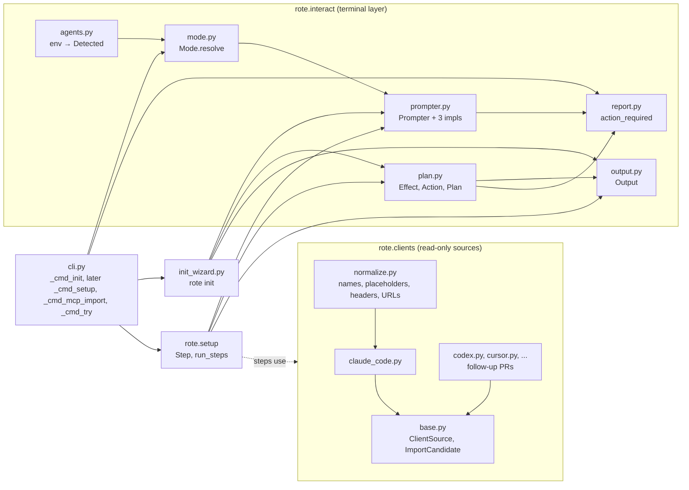
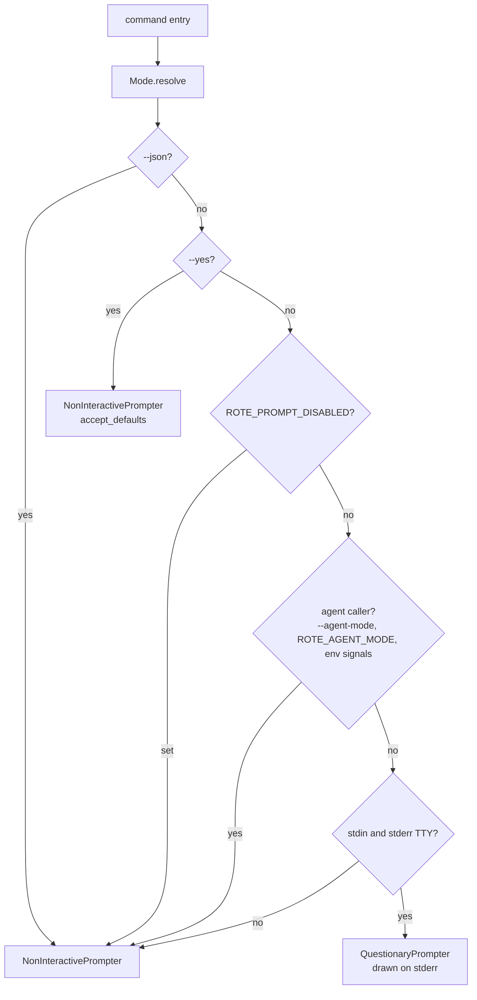
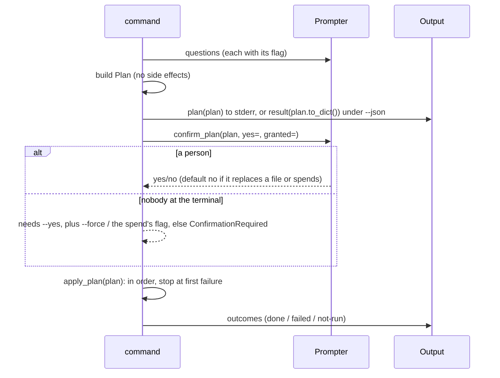
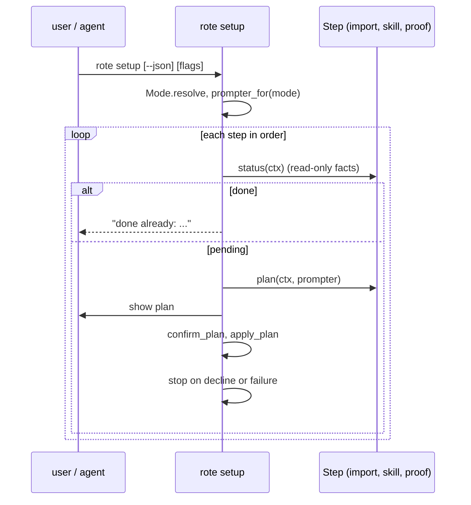

# First-run onboarding: architecture

Status: foundation landed (this PR). `rote setup` and its steps are follow-up
PRs built to the interfaces below. Product design: "rote first-run design"
(approved 2026-10-22, all nine recommendations taken).

The rule everything here serves: **every side effect is an Action in a Plan,
shown and confirmed before it runs, and interactivity is decided once, before
the first question.** A file write, a server contacted, a browser opened, or
money spent never happens inline in a command. It happens because a person
said yes to a plan that listed it, or because a script passed `--yes` (plus
`--force` to replace a file, plus the spend's own flag to spend money).

## What we took from which CLI

| Pattern | Source | Here |
| --- | --- | --- |
| One IO object decides `CanPrompt()` once; nothing else calls `isatty` | gh [`pkg/iostreams/iostreams.go`](https://github.com/cli/cli/blob/HEAD/pkg/iostreams/iostreams.go), [`internal/ghcmd/cmd.go`](https://github.com/cli/cli/blob/HEAD/internal/ghcmd/cmd.go) | `rote.interact.mode.Mode.resolve` |
| `GH_PROMPT_DISABLED` | gh | `ROTE_PROMPT_DISABLED` |
| A `Prompter` interface, stubbed per question in tests | gh [`internal/prompter/prompter.go`](https://github.com/cli/cli/blob/HEAD/internal/prompter/prompter.go), [`pr/create/create_test.go`](https://github.com/cli/cli/blob/HEAD/pkg/cmd/pr/create/create_test.go) | `rote.interact.prompter.Prompter`, `ScriptedPrompter` |
| Non-interactive errors name the flag to pass | gh `cmdutil.FlagErrorf("must provide --title ...")` in [`pr/create/create.go`](https://github.com/cli/cli/blob/HEAD/pkg/cmd/pr/create/create.go) | `PromptRequired`, exit 2 |
| Dependencies injected through one struct of fields | gh [`pkg/cmdutil/factory.go`](https://github.com/cli/cli/blob/HEAD/pkg/cmdutil/factory.go) | `ClientContext`, `SetupContext` |
| Agent detection from env, with an injectable lookup | gh [`internal/agents/detect.go`](https://github.com/cli/cli/blob/HEAD/internal/agents/detect.go), [`@vercel/detect-agent`](https://github.com/vercel/vercel/blob/HEAD/packages/detect-agent/src/index.ts) | `rote.interact.agents` |
| A detected agent means non-interactive | Vercel [`util/client.ts`](https://github.com/vercel/vercel/blob/HEAD/packages/cli/src/util/client.ts) (`nonInteractive = opts.nonInteractive ?? this.isAgent`) | `Mode.agent` |
| Prompts render to stderr, so stdout stays the result | Vercel `client.input` | `QuestionaryPrompter` (`create_output(stdout=sys.stderr)`) |
| `action_required` payload with `missing` and `next: [{command}]` | Vercel [`util/agent-output.ts`](https://github.com/vercel/vercel/blob/HEAD/packages/cli/src/util/agent-output.ts) | `rote.interact.report.action_required` |
| `--agent auto\|yes\|no` | Supabase [`internal/utils/agent.go`](https://github.com/supabase/cli/blob/HEAD/apps/cli-go/internal/utils/agent.go) | `--agent-mode` (see Deviations) |
| An unrecognized answer on a pipe is never consent | Supabase TS [`prompt-yes-no.ts`](https://github.com/supabase/cli/blob/HEAD/apps/cli/src/command-internal/prompt-yes-no.ts) (its Go version's default-on-timeout is the anti-pattern) | `NonInteractivePrompter` never reads stdin |
| Plan printed inside the confirmation; side effects documented per command | Supabase [`db-push-core.ts`](https://github.com/supabase/cli/blob/HEAD/apps/cli/src/command-internal/db-push-core.ts), [`SIDE_EFFECTS.md`](https://github.com/supabase/cli/blob/HEAD/apps/cli/src/commands/db/push/SIDE_EFFECTS.md) | `Plan` + `Effect` records |
| Login as a two-step resumable flow (`--non-interactive`, then `--complete`) | Stripe [`pkg/login/oauth_pending.go`](https://github.com/stripe/stripe-cli/blob/HEAD/pkg/login/oauth_pending.go), [`cmd/login.go`](https://github.com/stripe/stripe-cli/blob/HEAD/pkg/cmd/login.go) | `rote mcp login --no-wait` / `--complete` (PR 5) |
| Output channels as capabilities, not branches | uv [`printer.rs`](https://github.com/astral-sh/uv/blob/HEAD/crates/uv-command-support/src/printer.rs) | `rote.interact.output.Output` (`say` to stderr, `result` to stdout) |
| Steps that see earlier answers; cancel as a value | clack [`group.ts`](https://github.com/bombshell-dev/clack/blob/HEAD/packages/prompts/src/group.ts), [`core/utils`](https://github.com/bombshell-dev/clack/blob/HEAD/packages/core/src/utils/index.ts) | `SetupContext.results`; `PromptCancelled` |
| Plan/apply split; a trivial plan never prompts; JSON mode refuses rather than auto-approving | Terraform [`backend_apply.go`](https://github.com/hashicorp/terraform/blob/HEAD/internal/backend/local/backend_apply.go), [`arguments/apply.go`](https://github.com/hashicorp/terraform/blob/HEAD/internal/command/arguments/apply.go) | `confirm_plan`: empty plan needs nothing, `--json` without `--yes` stops |

Anti-patterns we avoid: Vercel's module-level `output` singleton (not
injectable), Vercel and Stripe re-checking `isTTY` at each decision point,
Supabase Go treating a pipe's silence as the default answer, and clack having
no non-interactive mode at all (the caller must gate it, which is what
`prompter_for` is).

## Module layout



`rote.interact` knows nothing about MCP or skills, and `rote.clients` knows
nothing about terminals. `rote.setup` and the commands are where they meet.

## Mode: decided once

`Mode.resolve(json=, yes=, agent_mode=, env=, stdin=, stdout=, stderr=)` reads
the terminal and environment one time. Every argument is injectable.



Agent signals have a **role**. A *caller* (`CLAUDE_CODE_CHILD_SESSION`,
`CODEX_THREAD_ID`, `GEMINI_CLI`, `AI_AGENT`, ...) means an agent process
started rote: no prompts. A *host* (`CLAUDECODE`, `CURSOR_TRACE_ID`,
`ZED_TERM`, and `REPL_ID` and `GOOSE_PROVIDER`, both set in a person's own
shell) only says which client's terminal this is. Claude Code sets
`CLAUDECODE=1` in IDE terminals too, where a person types. Hosts rank the
import sources and never turn prompts off. `AI_AGENT` is matched by prefix:
Claude Code 2.1.302 sets `AI_AGENT=claude-code_2-1-302_agent`.

stdout is not part of the decision: prompts draw on stderr, so
`rote setup | tee log` still asks.

**Why "decided before the first prompt" is a hard rule:** prompt_toolkit reads
a piped stdin as keystrokes. `printf '\r' | <questionary prompt>` returns the
default with only a warning on stderr, an empty pipe raises `EOFError`, and
`.ask()` prints "Cancelled by user" to *stdout* on Ctrl-C. So the CLI never
constructs a `QuestionaryPrompter` without a terminal, uses `unsafe_ask()`,
and `tests/test_init.py::test_piped_answers_never_reach_a_prompt` pipes
`\r\r\r...y\r` into a real `rote init` subprocess and requires exit 2 with
nothing written.

## Prompter

```python
class Prompter(Protocol):
    interactive: bool  # property
    def select(self, message, choices: Sequence[Choice[T]], *, flag, default=None) -> T
    def checkbox(self, message, choices, *, flag, default: Sequence[T] = ()) -> list[T]
    def confirm(self, message, *, flag, default: bool) -> bool
    def text(self, message, *, flag, default=None, validate=None) -> str
```

Every question names its flag. The command checks the flag first and asks
only when it is absent (gh's shape):

```python
runtime = flags.runtime or prompter.select("Which runtime?", RUNTIMES, flag="--runtime", default="dbos")
```

| Implementation | When | Behavior |
| --- | --- | --- |
| `QuestionaryPrompter` | a person at a terminal | questionary 2.1.1 on prompt_toolkit 3.0.53, output on stderr, `unsafe_ask()`, Ctrl-C/Ctrl-D raise `PromptCancelled`. `input=`/`output=` injectable (tests use `create_pipe_input` + `DummyOutput`). |
| `NonInteractivePrompter(why, accept_defaults)` | everything else | never reads stdin. With `--yes` returns each default. A question with no default, or any question without `--yes`, raises `PromptRequired(question, flag, why, choices)`. |
| `ScriptedPrompter(answers)` | tests | each `Answer(kind, flag, value)` must match the question it answers, so a test fails where the flow diverged. `DEFAULT` takes the question's default; `interactive_` simulates either side. |

`Choice(value, label, hint, disabled)`: a disabled choice is shown with its
reason (a stdio server, a URL with a query string) and can never be picked or
be a default.

`prompter.interactive` exists so a command can skip what only a person can do
(open a browser, offer a login). It never picks a different flow.

## Plan and Action

```python
Effect = FileWrite(path, summary, existed, replaces, file_mode)
       | Contact(host, purpose)        # a bare host: never a URL
       | Launch(program, purpose, paid)  # a browser, `claude -p`
       | Spend(low_usd, high_usd, payer, flag)

Action(id, title, effects: tuple[Effect, ...], run: Callable[[], object], command: str | None)
Plan(title, actions, notes)
Outcome(action_id, status, error, result)   # result = what run() returned
```

- An `Action` with no effects is refused: if nothing needs previewing it is
  not a side effect and does not belong in a plan.
- The code that applies an action is attached to the record that previews it,
  so the confirmation is about the real effects.
- `Action.command` is the exact standalone command that does the same thing
  (`rote mcp login figma`), which is what an agent runs later.
- **A write is re-checked at apply.** `write_file_action` records the file's
  state when the plan is made (absent, or the SHA-256 of its bytes), and its
  `run()` refuses with `StaleFile` ("changed since the plan was made; nothing
  written, re-run") when the file no longer matches. The check runs after the
  new content is staged and right before the rename, so the window left is the
  rename, not the minutes a person spends at "Apply this plan?". Without it, a
  plan confirmed as a create (so `--yes` alone sufficed) would silently replace
  a file that appeared meanwhile.
- **A paid launch carries its spend.** `Launch(paid=True)` (a compile, a skill
  run through `claude -p`) is refused by `Action` unless the same action holds
  a `Spend`, whose flag is what keeps `--yes` from ever starting it.



Consent rules, in `confirm_plan`:

| Effect | A person | Nobody at the terminal |
| --- | --- | --- |
| create or update a file, contact a host, launch a program | asked, default yes | `--yes` |
| replace an existing file | asked, default no | `--yes --force` |
| spend money | asked, default no | `--yes` plus the `Spend.flag` (`--live`). `--yes` alone never spends |

`atomic_write_text` (temp file in the same dir, `os.replace`, mode set before
the rename) is the one way an action writes a file. `rote.config.write_config`
now uses it too.

## `--json`: the same Plan, rendered once

rote's `--json` rule (one object on stdout) holds. A command that applied
prints `{"ok", "applied": true, "plan": plan.to_dict(), "outcomes": [...]}`.
A command that stopped prints an `action_required` object and exits 2:

```json
{
  "ok": false,
  "status": "action_required",
  "reason": "missing_answer",
  "message": "Which runtime should rote emit by default: pass --runtime <dbos|temporal|...> (...)",
  "missing": ["--runtime"],
  "choices": ["dbos", "temporal", "cloudflare", "dbos-ts", "inngest", "python"],
  "next": [{"command": "rote init --deploy none --json --runtime <dbos|temporal|...>"}]
}
```

`reason: "confirmation_required"` carries `"plan": plan.to_dict()` instead,
with `"needs": ["--yes", "--force", ...]`, so the agent can show the user what
would happen before it re-runs `next`. `next` is the user's own argv plus the
missing flags (`args.raw_argv`, set in `main`).

## Output

`Output(mode, stdout=None, stderr=None)`: `say`, `warn`, `error`, `plan` go to
stderr through rich (color only when stderr is a terminal and `NO_COLOR` is
unset); `result` writes the one JSON object to stdout under `--json` and
nothing otherwise. Streams resolve per write, so `cli._run_json_command`'s
redirection and pytest's capture see everything. Text from other apps' configs
is printed as rich `Text` with `markup=False`: a server named `[link=...]`
cannot restyle or relink a line.

## Client sources

```python
class ClientSource(Protocol):
    id: str       # "claude-code", the --from value and the agents.py client id
    label: str
    def config_paths(self, ctx: ClientContext) -> tuple[Path, ...]
    def detect(self, ctx: ClientContext) -> bool
    def read(self, ctx: ClientContext) -> SourceReading   # never raises for a bad file

ClientContext(home, cwd, env)          # injected; ClientContext.current() for real runs
SourceReading(client, candidates, files_read, problems)
ImportCandidate(client, name, original_name, scope, origin, transport, url (never shown),
                headers: tuple[HeaderTemplate], scopes, withheld, blocked, inactive, plugin)
```

A source only reads files. It never runs the client (`claude mcp list`
health-checks every server, work servers included), never contacts a server,
never writes, and never resolves a placeholder. `ClientContext` is the only
door to the machine, so tests point a source at fixture files and a source
cannot read the real home by accident; `ROTE_CLIENT_HOME_DIR` (in
`rote.isolation.STATE_PATHS`, so conftest and `scripts/isolated-rote` move it)
does the same for `ClientContext.current()`, dropping `CLAUDE_CONFIG_DIR`,
`CODEX_HOME` and `XDG_CONFIG_HOME` so they cannot lead back to the real files.

`rote.clients.normalize` holds the rules every source applies the same way:

- **Names** become identifiers (`acme-crm-prod` to `acme_crm_prod`, `9lives`
  to `_9lives`); the original is recorded.
- **Placeholders**: each client's syntax is a `PlaceholderSyntax`; references
  are rewritten to `${VAR}` and never resolved. A `${VAR:-default}` default is
  dropped and reported (it may be the secret). Client-internal variables
  (`${CLAUDE_PLUGIN_ROOT}`) and inputs (VS Code `${input:id}`) are unsupported.
- **Headers** are copied only when the value is references plus at most an
  auth scheme word (`Bearer ${GITHUB_TOKEN}`). Anything else is a literal,
  withheld with the `rote mcp add <name> <url> --header` command that sets it.
- **URLs** are copied only as plain http(s): no userinfo, no query string
  (API keys travel there), no placeholder.
- **Display**: `ImportCandidate.to_dict()` has the host, never the URL; header
  names and templates, never values; and `withheld`, each item with its reason.
  `headersHelper` and `oauth.clientId` (issued to Claude Code) are withheld.
- **A credential-shaped URL path** (`url_secret_risk`): a path segment of 20+
  characters mixing letters and digits with Shannon entropy of 3.5+ bits per
  character, or a 32+ hex run (UUID dashes removed), sets
  `ImportCandidate.risk`. Decided by the string's form, never a word list.
  Hosted servers put keys there (Zapier's `/mcp/<key>/sse`). Such a candidate
  is importable but not `preselectable`: no default and no `--yes` picks it;
  `rote mcp import` needs a per-server opt-in that names the risk
  (`--allow-url-secret <name>`). The reason never quotes the segment.
- `is_work_host(host, work_domains)`: suffix match on whole labels.
- **Collisions** (`rote.clients.collisions.find_collisions(candidates,
  registered)`): two active, importable candidates that map to one identifier
  with different URLs (`acme-crm`, `acme_crm`), or a name already registered
  with another URL. Found while planning, so `rote mcp import` resolves each
  one in the plan the user confirms (skip with a note, or `--rename`), never at
  the write. The rule for resolving them belongs to that PR.

Claude Code (this PR) reads user scope, local scope (nearest ancestor key of
`projects` in `~/.claude.json`), `.mcp.json` with its approval rules
(`enableAllProjectMcpServers`, `enabledMcpjsonServers`,
`disabledMcpjsonServers` across settings files and the `projects` entry;
committed `.claude/settings.json` approves only in a trusted folder; a disable
wins from anywhere), the `/mcp` toggle (`disabledMcpServers`), precedence
local > project > user with the loser marked shadowed, enabled plugins
(`installed_plugins.json` v2, `.mcp.json` wrapped or bare, `plugin.json`
`mcpServers` as a map, a JSON path, or a list; `.mcpb` bundles reported), and
`CLAUDE_CONFIG_DIR`. Shapes were checked against a real install by key name
only.

Managed policy (code.claude.com/docs/en/managed-mcp): `deniedMcpServers` is
merged from every settings file plus the system `managed-settings.json`
(`/Library/Application Support/ClaudeCode/` on macOS, `/etc/claude-code/` on
Linux, under `ClientContext.system_dir`), and a match blocks the candidate.
`serverName` matches exactly; `serverUrl` is read wider than Claude Code does
(ports ignored, case-insensitive), because a deny that matches too much only
skips an import. A `managed-mcp.json` marks every other server unused, since
Claude Code then loads only its servers. Not read, and said on every reading
(`SourceReading.limits`): MDM profiles, the Windows registry, claude.ai
server-managed settings, and `allowedMcpServers`; `managedMcpServers` is a
`problems` line when present.

Per-client facts for the follow-up sources (verify each against current docs
before coding its parser): Codex `$CODEX_HOME/config.toml` `[mcp_servers.<n>]`
(`url`, `bearer_token_env_var`, `env_http_headers`, `http_headers`); Cursor
`~/.cursor/mcp.json` and `.cursor/mcp.json` (`${env:VAR}`); VS Code
`.vscode/mcp.json` (`servers` + `inputs`, `${input:id}` unsupported) and
`~/.copilot/mcp-config.json`; Gemini `~/.gemini/settings.json` (`url` is SSE,
`httpUrl` is HTTP); OpenCode `~/.config/opencode/opencode.json` `mcp.<n>`
(`type: remote|local`, `{env:VAR}`); Zed `~/.config/zed/settings.json`
`context_servers`; Amp `~/.config/amp/settings.json` `amp.mcpServers`; Goose
`~/.config/goose/config.yaml` `extensions`; Windsurf/Devin
`~/.codeium/windsurf/mcp_config.json` or `~/.config/devin/mcp_config.json`
(`serverUrl` or `url`); Claude Desktop is stdio only, so every entry is listed
as not importable.

## Setup: steps, resumable from the world



```python
class Step(Protocol):
    id: str; title: str; command: str   # the standalone command (rote mcp import, rote try)
    def status(self, ctx: SetupContext) -> StepStatus   # "done" | "pending", from facts
    def plan(self, ctx: SetupContext, prompter: Prompter) -> Plan   # no side effects

run_steps(steps, ctx, prompter, granted=()) -> list[StepReport]
```

`run_steps` writes `ctx.results[step.id] = {action_id: result}` after the
step's plan is applied, from each action's `run()` return value. A step never
writes results while planning: the plan may be declined or fail, and the next
step must read what happened, not what was intended.

Resumability comes from `status()` reading the world (servers in the registry,
token files, a chosen skill), not from a setup state file: an interrupted run
re-runs, the finished steps say "done already", and the rest continue. The one
fact the world does not hold, the chosen skill, is stored by the skill step in
user config when that PR lands. Each step is also its own idempotent command,
which builds the same `Step` and calls `run_steps([step], ...)`.

Under an agent, `rote setup --json` prints each step's status and its plan as
of now, with `command` for each action; the agent relays the choices and runs
the commands one step at a time (the `/rote:setup` plugin skill drives this).

`rote init` is the first command on this layer (`init_wizard.build_plan`
returns the Plan; `_cmd_init` confirms and applies). It becomes setup's
defaults step, and `rote init` stays as an alias.

## Deviations from the product design

- **`--agent-mode auto|yes|no`, not `--agent`.** `--agent` already names the
  compiler driver on `compile`, `analyze` and `init`, and setup absorbs init.
  `ROTE_AGENT_MODE` is its environment twin.
- **One missing answer at a time.** A non-interactive run stops at the first
  question without an answer, because later questions depend on earlier ones
  (`--runtime` is asked only for local hosting). `--yes` answers all of them.

## Open items the follow-up PRs own

- **`rote init --login` without a person** is refused (the device flow polls
  for a browser approval nobody can give). It works once `rote login` gets the
  `--no-wait` / `--complete` split.
- **Two raw `input()` prompts remain in `cli.py`**: the baseline-input confirm
  ("Run the baseline with this input?") and the "Send them?" confirm. They
  predate this layer; move both onto `Prompter` + `Plan` (the baseline run is a
  paid `Launch` with its `Spend`).

- **`${VAR}` in registry headers.** The registry stores headers as literal
  strings and neither runtime helper expands them. `rote mcp import` must add
  `${VAR}` expansion to `rote.mcp._runtime_helper` and the three TS helpers
  (one shared rule, a parity test, a missing variable as a config error like
  `RoteMcpConfigError`) before it can write a templated header.
- **Work domains** are a list; `rote.config` holds strings only. The import PR
  adds a `work_domains` key (comma-separated, validated as hostnames) or a list
  type to config, plus `--work-domain`.
- **Name collisions**: two clients (or a plugin and the user scope) mapping to
  one identifier, and an identifier already in the registry with another URL.
  Import resolves them in its plan (skip with a note, or `--rename a=b`).

## Remaining PRs

| # | PR | Builds on | Parallel with |
| --- | --- | --- | --- |
| 2 | Other client sources (Codex, Cursor, VS Code/Copilot, Gemini, OpenCode, Zed, Amp, Goose, Windsurf/Devin, Claude Desktop), one module each | `ClientSource`, `normalize` | 3, 4, 5, 6 (split per client if wanted) |
| 3 | `rote mcp import` (+ header expansion in the runtime helpers, work domains, collision rules) | `ClientSource`, `Plan`, `Prompter` | 2, 4, 5, 6 |
| 4 | `rote mcp login --no-wait` / `--complete` (Stripe's pending-file shape, atomic) | `Plan`, `report` | 2, 3, 5, 6 |
| 5 | Skill discovery and ranking (client skill dirs, enabled plugins, ranked by servers registered and logged in) | `ClientContext`, `Prompter` | 2, 3, 4, 6 |
| 6 | Bundle docs-digest into examples/ and the wheel, with a recorded reference run | none | 2, 3, 4, 5 |
| 7 | `rote try` (precompiled proof, then the live path with `Spend(flag="--live")`, field-by-field report). Landed: `rote.proof`, a `rote.setup.Step` | 6, `Plan` | 2, 3, 4, 5 |
| 8 | `rote setup` (steps from 3, 5, 7 plus init's defaults; first-run banner on bare `rote`) | 3, 4, 5, 7 | 9 once its JSON is fixed |
| 9 | `/rote:setup` plugin skill + AGENTS.md section | 8's `--json` shape | 10 |
| 10 | Fresh-install test: a real TTY (pty), inside Claude Code, and CI | 8 | 9 |
